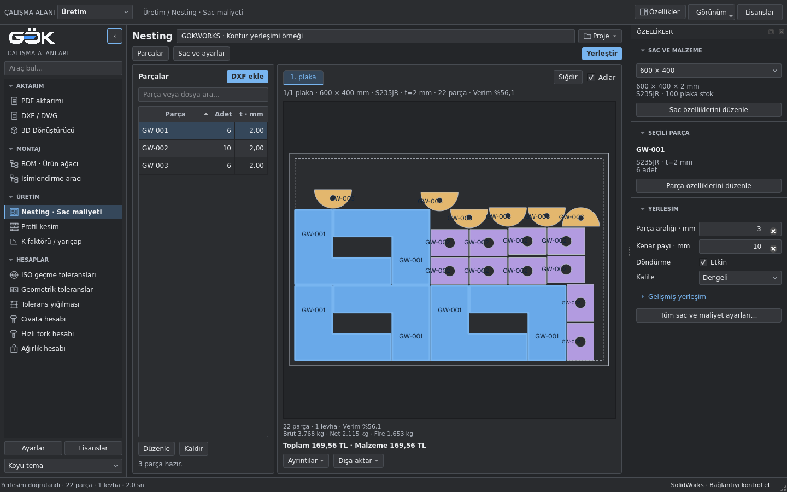

# GOKWORKS

**SolidWorks aktarımı, sac üretimi hazırlığı ve günlük mühendislik hesapları için masaüstü araçları.**

GOKWORKS; teknik resimleri PDF’e aktarmayı, sac açınımlarını dışa almayı,
montajların ürün ağacını çıkarmayı ve dosyaları yeni adlarla paketlemeyi tek
arayüzde bir araya getirir. Tolerans, cıvata, tork ve ağırlık hesapları ile
DXF parçalarının sac levhalara yerleştirilmesi için de araçlar sunar.

Uygulama Türkçe arayüz, açık/koyu tema ve yerel dosyalarla çalışma düzenine
sahiptir. CAD işlemleri Windows’ta açık SolidWorks oturumuyla çalışır;
bağımsız hesaplar ve nesting için SolidWorks gerekmez.

[İndirme ve kurulum](#indirme-ve-kurulum) · [Modüller](#modüller) ·
[Kullanım](#nasıl-kullanılır) · [Kaynak kod](#kaynak-koddan-çalıştırma)



*Güncel kaynak arayüz: parça listesi, sac yerleşimi ve bağlamsal özellikler paneli.*

[Yeni çalışma alanının kullanımı ve ekran görüntüleri](docs/fusion-workspace/README.md).
Bu arayüz kaynak kodda bulunur; aşağıdaki son başarılı EXE bağlantısının sürümü ayrıca belirtilmiştir.

## İndirme ve kurulum

**Paylaşım sayfası:** [release dalı](https://github.com/gkkizil/gokworks/tree/release).
Hazır uygulamayı indirmek için aşağıdaki doğrudan EXE bağlantısını kullanın;
**Code → Download ZIP** kaynak kodu indirir.

<!-- windows-release:start -->
**Son başarılı Windows EXE:** [GOKWORKS.exe indir](https://github.com/gkkizil/gokworks/releases/download/windows-onefile-40269740321-1/GOKWORKS.exe)

**GOKWORKS.exe** tek başına çalışır; yanında klasör gerekmez. Windows 10/11 x64; Python kurulumu gerekmez.

Uygulama kodu: `c2ad88d` · [Derleme kaydı](https://github.com/gkkizil/gokworks/actions/runs/40269740321) · [Paket bilgisi ve SHA256](packaging/latest-windows.json)
<!-- windows-release:end -->

1. Yukarıdaki bağlantıdan `GOKWORKS.exe` dosyasını indirin.
2. Dosyayı bilgisayarınızda bir klasöre kaydedip çalıştırın.
3. Sol menüden kullanacağınız aracı seçin. CAD işlemi yapacaksanız SolidWorks’ü
   açın ve ilgili montajı, parçayı veya teknik resmi etkinleştirin.

Hazır paketin sürüm bilgisi yukarıdaki derleme kaydındadır. Bu daldaki kaynak
kod, son EXE yayınından daha yeni değişiklikler içerebilir. EXE'nin içerdiği
sürüm, indirme bağlantısının yanındaki **Uygulama kodu** ile belirtilir.

### Gereksinimler

| Kullanım | Gereksinim |
| --- | --- |
| Hazır EXE ile çalışma | Windows 10/11, 64 bit. Python kurulumu gerekmez. |
| CAD aktarımı ve montaj işlemleri | Kurulu SolidWorks ve aynı Windows kullanıcı oturumunda açık SolidWorks. |
| Mühendislik hesapları ve DXF nesting | SolidWorks bağlantısı gerekmez. |
| Kaynak koddan çalışma | Python 3.13 ve `requirements.txt` bağımlılıkları. |

Excel raporları için Microsoft Excel, DXF nesting için AutoCAD kurulumu
gerekmez. CAD entegrasyonu mevcut SolidWorks kurulumunuzu kullanır.

## Modüller

### Aktarım ve montaj

| Modül | Ne yapar? |
| --- | --- |
| [PDF aktarımı](modules/pdf/README.md) | Klasördeki `.SLDDRW` dosyalarını tarar; her teknik resmin tüm sayfalarını tek bir PDF’e aktarır. |
| [DXF / DWG](modules/dxf_dwg/README.md) | Sac parçalarının açınımlarını dışa aktarır; kalınlık ve aktif montajdaki adet bilgisiyle dosyaları düzenler. |
| [3D Dönüştürücü](modules/cad_converter/README.md) | SLDPRT/SLDASM modellerini birden fazla STEP, Parasolid, IGES ve STL formatına toplu aktarır; konfigürasyon ve montaj bileşeni seçenekleri vardır. |
| [BOM · Ürün ağacı](modules/bom/README.md) | Aktif montajın parça listesini, alt montaj hiyerarşisini, adetlerini ve okunabilen ağırlıklarını çıkarır; Excel’e kaydeder. |
| [İsimlendirme aracı](modules/naming/README.md) | Montaj, parça ve teknik resim referanslarını koruyarak yeni adlarla ayrı bir Pack and Go paketi oluşturur. |

Bu aktarım modülleri için SolidWorks bağlantısı gerekir. 3D Dönüştürücüde
AP242 yayınlaması ayrıca uygun SolidWorks MBD lisansı gerektirir.

### Mühendislik hesapları

| Modül | Ne yapar? |
| --- | --- |
| [K faktörü / yarıçap](modules/k_factor/README.md) | Girilen kalınlık–K–R satırlarını montajdaki sac parçalarla eşleştirip SheetMetal parametrelerini günceller. Ayrı hesap yardımında BA/BD ve takım kesiti bulunur. |
| [ISO geçme toleransları](modules/iso_fits/README.md) | Delik/mil limitlerini ve boşluk–sıkılık durumunu hesaplar. Standart sınıflar ve manuel tolerans girişi desteklenir. |
| [Geometrik toleranslar](modules/geometric_tolerances/README.md) | GD&T özelliklerini, datum ilişkilerini ve tolerans bölgelerini açıklamalar ve şemalarla gösterir. |
| [Tolerans yığılması](modules/tolerance_stack/README.md) | Kullanıcının kurduğu 1D ölçü zincirini Worst-Case, RSS ve Monte Carlo yöntemleriyle analiz eder. |
| [Cıvata hesabı](modules/bolt/README.md) | Çekme, kesme ve birleşik yükler için statik dayanım, emniyet ve gerekli cıvata adedini hesaplar. |
| [Hızlı tork hesabı](modules/bolt_torque/README.md) | M3–M36 metrik cıvatalar için kalite sınıfı, diş adımı, K katsayısı ve hedef ön yüke göre tahmini sıkma torku verir. |
| [Ağırlık hesabı](modules/weight/README.md) | Malzeme, kesit, ölçü, boy ve adede göre ağırlık hesaplar. Malzemelerin tanımlı yoğunlukları otomatik kullanılır. |
| [Nesting · Sac maliyeti](modules/nesting/README.md) | DXF konturlarını birden fazla levhaya yerleştirir; alan verimini, net/brüt/fire ağırlıklarını ve maliyetleri hesaplar. |
| [Profil kesim optimizasyonu](modules/profile_cutting/README.md) | SolidWorks Weldments Cut List verilerini tarar; incelenen profilleri manuel listeye ekler, stok boyu ve testere payıyla 1D kesim planı oluşturur. |

K/R değerlerini CAD dosyalarına yazmak ve tolerans yığılmasında teknik resim
okumak veya anotasyon eklemek SolidWorks gerektirir. Bu araçların bağımsız
hesapları ve manuel tolerans analizi SolidWorks olmadan kullanılabilir.
Profil kesim planı da çevrimdışı çalışır; otomatik Weldments taraması açık ve
lisanslı yerel SolidWorks gerektirir. [Kullanım ve doğrulama sınırları](modules/profile_cutting/README.md).

## Nasıl kullanılır?

Sol menüden bir modül seçin, kaynak dosyaları veya hesap değerlerini girin ve
ilgili işlemi başlatın. Aktarım ekranlarında kaynak/ayarlar solda, sonuçlar ve
günlük sağdadır. Sütun genişliğini aradaki ayırıcıyı sürükleyerek değiştirebilirsiniz.

Üstteki **Çalışma alanı** listesinden Aktarım, Montaj, Üretim veya Hesaplar
grubuna geçebilirsiniz. **Ctrl+K** araç aramasını açar; **Ctrl+B** sol gezgini
simgelere daraltır. Ana işlem komutları ekranın üstünde kalır. Nesting'de
**Özellikler** seçili parçayı, sacı ve yerleşim ayarlarını gösterir; panel
dar pencerelerde çizim alanını korumak için gizlenir ve düğmeyle ayrı pencere
olarak açılabilir. **Görünüm** menüsünden açık/koyu tema seçilir.

Dosya sonuçları aranabilir ve durumlarına göre filtrelenebilir. Bir satıra
çift tıklayarak ayrıntılarını açabilirsiniz. **Temizle**, listeyi, sonuçları,
günlüğü ve filtreleri sıfırlar. **Durdur**, devam eden CAD kaydı tamamlandıktan
sonra sonraki dosyaya geçilmesini engeller.

### Teknik resimleri PDF’e aktarma

1. **PDF aktarımı** ekranında kaynak klasörü ve çıktı klasörünü seçin.
2. Alt klasörlerin taranmasını ve mevcut çıktıların üzerine yazılmasını ayarlayın.
3. **Klasörü tara** ile bulunan teknik resimleri kontrol edin.
4. **Aktarımı başlat** düğmesine basın; dosya durumlarını ve günlüğü izleyin.

Her teknik resim için ayrı PDF oluşturulur; resmin bütün sayfaları aynı PDF’te
yer alır. Üzerine yazma kapalıyken mevcut çıktılar atlanır.

### Sac metal açınımı

1. SolidWorks’te adetlerin alınacağı ana montajı ve doğru konfigürasyonu etkinleştirin.
2. **DXF / DWG** ekranında sac parçalarının kaynak klasörünü ve çıktı klasörünü seçin.
3. Çıktı türünü belirleyin; gerekirse büküm çizgilerini ve kalınlığa göre klasörlemeyi açın.
4. **Klasörü tara** ile dosyaları kontrol edip **Aktarımı başlat** düğmesine basın.

Örnek çıktı düzeni:

```text
Çıktı/
├── 1,5 mm/
│   └── BRAKET - 1.5 mm - 12 adet.dxf
└── 2 mm/
    └── KAPAK - 2 mm - 3 adet.dxf
```

Aktarım, parçaların aktif konfigürasyonunu kullanır; bütün konfigürasyonları
otomatik dolaşmaz. Tek gövdeli sac parçalar desteklenir. Kaynak montajdaki
konfigürasyon, adet ve açınım gereksinimleri için [modül kılavuzuna](docs/dxf-dwg-verification.md) bakın.

### Montaj dosyalarını yeniden isimlendirme

**İsimlendirme aracı** ekranında montajın bulunduğu klasörü ve yeni paketin
kaydedileceği boş/yeni hedef klasörü seçin. **Montajları bul** ile kaynak montajı
belirleyip **Dosyaları oku** düğmesine basın. Ön/son ek, numaralandırma veya
bul–değiştir kurallarını girin; önizlemeyi kontrol edip **Paketi oluştur** ile
kaydedin. Çıktı, dosya referansları kontrol edilen ayrı bir pakettir.

### Sac parçalarına K/R atama

**K faktörü / yarıçap → Manuel K / R** bölümünde her kalınlığın yanına K faktörünü
ve iç yarıçapı yazın. **Montajı tara** değişiklik yapmadan eşleşmeleri gösterir.
Sonuçları kontrol edip **Montaja K/R uygula** düğmesine basın. Sac olmayan ve
girilen kalınlıklarla eşleşmeyen parçalar atlanır; mevcut sac kalınlığı korunur.
Dosyaları kaydetme seçeneği başlangıçta kapalıdır. [Ayrıntılı kullanım](docs/manual-k-radius.md).

### Tolerans zinciri oluşturma

Teknik resim ölçülerini okuyun veya manuel ölçü girin. Sonuca eklenecek ölçüleri
**+ Topla**, çıkarılacakları **− Çıkar** ile zincire alın. Ölçülerin aynı doğrultu
ve ortak referansa ait olduğunu kontrol edin, kabul sınırlarını girip hesaplayın.
Sonuçları PDF/Excel olarak alabilir veya teknik resme ayrı analiz notları
ekleyebilirsiniz. Üretim ölçüleri otomatik değiştirilmez.

### DXF parçalarını saclara yerleştirme

**Nesting · Sac maliyeti** ekranında DXF dosyalarını topluca ekleyin; parça
adetlerini, malzemelerini ve kalınlıklarını belirtin. **Sac ve ayarlar** içinde
levha boyutunu, stok adedini, fiyatı ve yerleşim paylarını tanımlayın.
**Yerleştir** ile hesabı başlatın. Motor, uygun parçalarla ilk plakayı doldurup
gerektikçe sonraki plakaya geçer. **1. plaka / 2. plaka / …** sekmeleriyle
yerleşimleri inceleyin; tamamlanan yerleşimi **Dışa aktar** menüsünden kaydedin.
Sığan küçük parçalar büyük parçaların deliklerine otomatik ve öncelikli
yerleştirilir; ayrıca seçenek açmanız gerekmez. DXF yanındaki `KESIM-SIRASI.csv`, bu
parçaların çevreleyen deliklerden önce kesilmesi için önerilen sırayı içerir;
bu sıra CAM yazılımında uygulanmalıdır.

## Kayıtlar ve çalışma kapsamı

Klasör seçimleri ve arayüz tercihleri kullanıcı profilinde saklanır.
Tolerans ve nesting projeleri ayrıca kaydedilip yeniden açılabilir.
Aktarım sonuçları, raporlar ve hata günlükleri bilgisayarda tutulur.
Windows günlük klasörü: `%LOCALAPPDATA%\GOKWORKS\logs`.

K/R uygulaması model parametrelerini değiştirir; kaynak teknik resme analiz
kaydı ise ayrı bir onay gerektirir. Bu işlemlerde kayıt seçimini kontrol edin.
Hesap sonuçları belirtilen malzeme, tolerans, yük ve dağılım varsayımlarına
bağlıdır. Tork ve statik cıvata sonuçları ön değerlendirmedir; kritik bağlantılarda
üretici şartnamesi esas alınır. Nesting sonucu en iyi yerleşim garantisi veya
doğrudan makine programı değildir; kerf telafisi CAM tarafında yapılır.
RSS/Monte Carlo sonuçları ölçülmüş üretim prosesi kabiliyeti olarak yorumlanmamalıdır.

## Kaynak koddan çalıştırma

Yazılım geliştirmesi **`main`** dalında yapılır. **`release`**, paylaşım için
ayrılan yayın dalıdır; yalnız yayın sorumlusunun açık isteğiyle güncellenir.
`main` değişiklikleri bu dala otomatik aktarılmaz.
[Yayın ve güncelleme düzeni](docs/releases.md).

Python 3.13 kurulu bir Windows bilgisayarında, proje klasöründe:

```powershell
py -3.13 -m venv .venv
.venv\Scripts\python.exe -m pip install -r requirements.txt
.venv\Scripts\python.exe main.py
```

Arayüz **PySide6 / Qt Widgets** kullanır. SolidWorks bağlantısı `pywin32`
üzerinden kurulur; Excel çıktıları `openpyxl`, DXF işlemleri `ezdxf`, yerleşim
geometrisi `Shapely/GEOS` ile hazırlanır. Temel hesaplar yerel Python kodudur.

Her özellik `modules/<modül>/` altında kendi hesap/CAD kodu, `ui.py` arayüzü,
testleri ve rehberiyle bulunur. [Modül dizini](modules/README.md) ·
[Depo yapısı](docs/repository-structure.md) · [Windows paketleme](packaging/README.md).

Geliştirme testleri:

```powershell
.venv\Scripts\python.exe -m pip install -r requirements-dev.txt
.venv\Scripts\python.exe -m pytest
```

Linux’ta hesap ve arayüz testleri ekran olmadan `QT_QPA_PLATFORM=offscreen`
ile çalıştırılabilir. SolidWorks COM entegrasyonu Windows ortamı gerektirir.
[Test ve geliştirme kayıtları](docs/development-history.md) ayrı tutulur;
gerçek SolidWorks gerektiren kontrollerin kapsamı ilgili raporlarda belirtilir.

## Belgeler ve kaynaklar

- [Modüllerin kullanım rehberleri](modules/README.md)
- [Tolerans yığılması: yöntemler ve kullanım](docs/tolerance-stack.md)
- [Nesting: hesaplar ve sınırlar](docs/nesting.md)
- [24 Ekim 2026: uygulama testleri, stres koşuları ve sınırlar](docs/verification-2026-10-24/README.md)
- [Kaynak ve telif envanteri](sources/README.md)
- [Üçüncü taraf lisans bildirimleri](docs/THIRD_PARTY_NOTICES.md)

Kullanılan kütüphanelerin lisans metinleri uygulamadaki **Lisanslar** bölümünden
görüntülenebilir ve kaydedilebilir.
