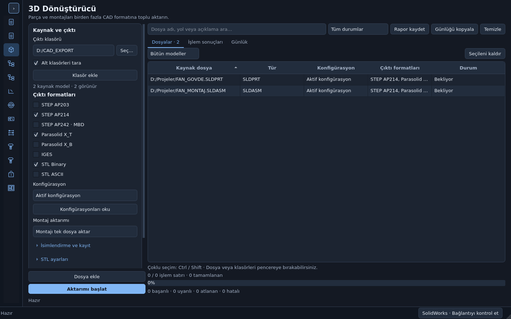

# 3D CAD Toplu Dosya Dönüştürücü · Uygulama raporu

22 Ekim 2026 · GOKWORKS `main`. Mevcut PySide6/Qt Widgets mimarisi korunarak
**Aktarım ve Montaj → 3D Dönüştürücü** ekranı eklendi. Kaynak geliştirmesi
`main` üzerindedir; bu görev `release` dalını veya yedek depoyu güncellemez.

## Kullanıcı akışı

**Dosya ekle / Klasör ekle / sürükle-bırak → çıktı klasörü → formatlar →
konfigürasyon ve montaj modu → Aktarımı başlat**. Seçilen her format kendi
klasörüne yazılır. Aynı uzantıyı kullanan STEP protokolleri ve STL kodlamaları
birbirini ezmez. Sağdaki **Dosyalar / İşlem sonuçları / Günlük** sekmeleri,
bir kaynak için birden fazla konfigürasyon/format sonucunu ayrı saklar.



[Açık tema](cad-converter/light.png) · [Küçük pencere](cad-converter/small.png).
Görseller gerçek Qt ekranından alınmıştır; örnek dosya adları gerçek CAD
aktarımı kanıtı olarak sunulmaz.

## Eklenen dosyalar

`modules/cad_converter/` bağımsız modül paketi:

| Dosya | Sorumluluk |
| --- | --- |
| `__init__.py` | Modül girişi |
| `formats.py` | Sekiz format kimliği, ayrı klasör/uzantılar |
| `models.py` | Kaynak, seçenek, sonuç, kooperatif iptal |
| `scanner.py` | Çoklu dosya/klasör, alt klasör, fiziksel dosya tekilleştirme |
| `naming.py` | Windows adları, konfigürasyon/kaynak çakışması, atomik yayımlama |
| `api.py` | STA, gerçek COM arayüzleri, kurulu enumlar ve oturum koruması |
| `exporter.py` | Aktarım sırası, montaj/konfigürasyonlar, dosya bazlı sonuçlar |
| `validation.py` | Format yapısı ve yanlış/yarım çıktı reddi |
| `report.py` | Atomik CSV/XLSX sonuç raporu ve sayaçlar |
| `ui.py` | Mevcut tema, tablo, katlanır ayarlar, iki sütunlu ekran |
| `README.md` | Kullanım ve sınırlar |
| `tests/` | Saf Python, COM mock, gerçek Qt ve isteğe bağlı Windows testi |

`docs/cad-converter/`: sabit kaynak/lisans kayıtları, interop sözleşmesi
kanıtı, test/öz denetim raporları ve ekran görüntüleri. Bu raporun kendisi
`docs/CAD_CONVERTER_IMPLEMENTATION.md` dosyasındadır.

## Değiştirilen mevcut dosyalar

- `gui_qt/app.py`: mevcut kalıcı sayfalar ve navigasyona yeni modül.
- `gui_qt/icons.py`: mevcut vektör stilinde 3D küp ikonu.
- `gui_qt/package_check.py`: 13 ekranın tema/çözünürlük denetimine ek olarak
  yeni format, kuyruk, ayar ve temizleme kontrolü; canlı COM kullanılmaz.
- `packaging/build_windows.py`: dağıtım bilgisine 3D format/lisans koşulları.
  Modül normal Python importlarıyla PyInstaller'a girer; ek bir ikili araç,
  yeni bağımlılık veya zorunlu veri dosyası eklenmedi.
- `README.md`, `modules/README.md`, `docs/repository-structure.md`,
  `docs/THIRD_PARTY_NOTICES.md`: kullanım, modül konumu ve kaynak kaydı.

PDF, DXF/DWG, BOM, K/R, tolerans, nesting ve hesap motorları değiştirilmedi.

## Format/API eşleştirmesi

| Seçim | Çıkış | API davranışı |
| --- | --- | --- |
| STEP AP203 | `STEP_AP203/*.step` | `swStepAP=203`, katı/yüzey aktarımı |
| STEP AP214 | `STEP_AP214/*.step` | `swStepAP=214`, katı/yüzey aktarımı |
| STEP AP242 | `STEP_AP242/*.step` | `PublishSTEP242File(Path)`; MBD lisans hata kodu kontrolü |
| Parasolid text | `PARASOLID_XT/*.x_t` | `IModelDocExtension.SaveAs3` |
| Parasolid binary | `PARASOLID_XB/*.x_b` | `IModelDocExtension.SaveAs3` |
| IGES | `IGES/*.igs` | B-Rep/katı-yüzey, tek dosya; tercihler geri alınır |
| STL binary | `STL_BINARY/*.stl` | Binary, birim ve mesh tercihleri |
| STL ASCII | `STL_ASCII/*.stl` | ASCII, birim ve mesh tercihleri |

AP204 yoktur. AP242, normal STEP ayarını 242 yaparak taklit edilmez. AP242
lisans başarısı ve dosya şeması birlikte kontrol edilir; bu, PMI içeriğinin
eksiksizliği veya katı geometriyle eşdeğerliği için sertifika değildir.

`OpenDoc6` sessiz/salt okunur ve lightweight varsayılanını geçersiz kılan
seçeneklerle çağrılır. `ActivateDoc3` doğru modelin aktif olduğunu doğrular.
Konfigürasyon için `GetConfigurationNames` / `ShowConfiguration2`, gerektiğinde
`EditRebuild3`; bütün model için `ClearSelection2(True)` kullanılır. Seçim
listesi askıya alınarak kullanıcı seçimi geri getirilebilir tutulur.

`SaveAs3(Name, Version, Options, ExportData, AdvancedSaveAsOptions, Errors,
Warnings)` sessiz+kopya seçenekleri ve gerçek `[out] int` değişkenlerle
çağrılır. Desteklenmeyen imzada tahmini parametrelerle tekrar denenmez.
`SaveAs` eski imzası da araştırılmıştır; 2025 hedefi için yedi parametreli
`IModelDocExtension.SaveAs3` kullanılır, `IModelDoc2.SaveAs3` ile karıştırılmaz.

## API doğrulamasının kanıtı ve sınırı

Resmî 2025 `OpenDoc6`, `ActivateDoc3`, `SaveAs`, `SaveAs3`,
`PublishSTEP242File` ve tercih enum belgelerine erişim denendi. Bu çalışma
ortamının ağ geçidi `help.solidworks.com` için **HTTP 403** verdi; resmî 2025
belgelerinin bu oturumda okunup doğrulandığı iddia edilmez.

Araştırmada Dassault Systèmes interop tiplerini taşıyan NuGet
`SolidWorks.Interop.sldworks` / `swconst` **32.1.0 (2024 SP1)** metadata'sı
incelendi; parametre yönleri, dönüş tipleri, arayüz GUID'leri ve enum adları
okundu. Bu metadata 2025 SP5 canlı uyumluluk testi yerine geçmez.
[İmzalar, gözlenen enumlar ve SHA256](cad-converter/api-evidence.json).

Üretim kodu bu araştırma DLL'lerini veya sayısal tercih kimliklerini gömmez.
Çalışırken açık SolidWorks'ün kurulumundaki `swconst.tlb`, ardından kayıtlı
constant tür kitaplıkları okunur. Registry sürümlerinin hexadecimal olması
ve pywin32 `TYPEATTR`/`VARDESC` yapıları ayrıca test edilir. Eksik enum veya
bozuk COM kaydında tahmini bir kimlikle devam edilmez; anlaşılır hata verilir.

## Oturum ve dosya güvenliği

- Kaynak kaydetme/silme/yeniden adlandırma çağrısı yoktur.
- Yalnız aracın doğrudan açtığı belgeler kapatılır. `AlreadyOpen` uyarısı
  kullanıcı sahipliği olarak korunur. Önceden açık belgeler kapatılmaz.
- Her konfigürasyon ve seçim listesi, iş bitiminde önceki aktif belge geri
  getirilir. STEP/STL/IGES tercihleri değişiklikten önce topluca alınır;
  mod/kalite ile ilişkili sayısal ayarlar doğru sırayla geri yüklenip okunur.
- Geri alma başarısızsa toplu aktarım durur. COM arayüzleri arka plan iş
  parçacığında tutulur; kritik hata/iptal izlerinde çocuk COM referansları
  `CoUninitialize` öncesinde bırakılır.
- Benzersiz geçici hedef, format kontrolünden ve tercih geri almadan sonra
  yayımlanır. Varsayılan atla davranışı yarış durumunda da mevcut dosyayı
  ezmez. İptalde yayımlanmamış çıktı temizlenir; çalışan COM çağrısı öldürülmez.

## Montajlar ve konfigürasyonlar

Aktif/bütün/seçilen konfigürasyonlar ayrı dosyalar üretir. Aynı temizlenmiş
ada dönüşen konfigürasyonlar da çakışmaz. Ayrı bileşen modunda montajın
referans verdiği dosya/konfigürasyon çifti kullanılır; aynı çift tekrar
aktarılmaz. İstenirse alt montajın kendisi de ayrı çıktı olur.

Bastırılmış bileşenler atlanan olarak raporlanır. Ayrı parça olarak
çözümlenebilen lightweight dosyalar açılır. Tek dosya montaj çıktısında tam
çözümlenmeyen geometri veya eksik referans varsa kısmi başarı ilan edilmez.
Sanal bileşen için bağımsız dosyaya kaydetme açıklaması verilir. Haricî
referanslar taranır; bulunamayan referanslar dosya bazlı hatadır.

## Araştırılan açık kaynaklar ve lisanslar

| Proje | Lisans | İncelenen yaklaşım |
| --- | --- | --- |
| xarial/codestack | MIT | Çoklu format/konfigürasyon akışı, STEP tercihini geri alma, SaveAs |
| xarial/xcad | MIT | SaveAs3 sürüm seçimi, hata kodları, STEP ayar yaşam döngüsü |
| codestackdev/solidworks-api-examples | MIT | Bileşen modeli, ayrı aktarım, eksik model hatası |
| DalessandroJ/PythonOCC-CAD-Converter | MIT | Toplu dönüştürme ve mesh seçenekleri; SolidWorks girişlerini okumaz |

[Dokuz dosyanın sabit commit, lisans ve SHA256 kaydı](cad-converter/references.json).
Kaynaklar incelendi; kodları doğrudan kopyalanmadı. PythonOCC/PyQt5, CAD+
Macro+ veya yeni ticari eklenti bağımlılığı eklenmedi. Mevcut CodeStack MIT
bildirimi ve mevcut bağımlılıkların lisans dağıtımı korunur.

## Çalıştırma ve doğrulama

```bash
python main.py
QT_QPA_PLATFORM=offscreen python packaging/run_windows_tests.py
QT_QPA_PLATFORM=offscreen python -m pytest modules/cad_converter/tests
QT_QPA_PLATFORM=offscreen python main.py --self-check /tmp/GOKWORKS-check.json
```

[Kaynak öz denetimi](cad-converter/selfcheck.json): 13 modül, koyu/açık tema,
1024×700 / 1366×768 / 1920×1080 / 2560×1440 çözünürlükler geçti. Yeni ekranın
kuyruk, seçenek ve temizleme kontrolleri ve mevcut modüllerin öz denetimleri
çalıştırıldı. Genel test koşusunda **1049 test ve 878 alt senaryo geçti**;
gerçek Windows/SolidWorks gerektiren **8 test atlandı**. Toplanan 1057 testin
tamamı 34 taze süreç grubunda çalıştırıldı; hata veya test kaybı yoktur.
Son kodla yeni modül ayrıca çalıştırıldı: **104 geçti, 1 canlı test atlandı**.
Bu tekrar genel toplam üzerine ayrıca eklenmez.
[Komutlar, atlama nedenleri ve kaynak SHA256 kayıtları](cad-converter/checks.json).

## Gerçek Windows/SolidWorks doğrulaması gerekenler

Bu görev Linux/Qt offscreen üzerinde geliştirilmiştir. Gerçek SolidWorks
2025 SP5, MBD lisansı, gerçek Parasolid/STL çeviricileri veya yeni Windows
EXE bu ortamda çalıştırılmadı. Bunlar mock başarılarıyla eş tutulmaz.
İsteğe bağlı gerçek entegrasyon testi `tests/test_live.py` içindedir;
Windows'ta açık SolidWorks ve `GOKWORKS_CAD_LIVE_SOURCE` test kopyası gerekir.
`GOKWORKS_CAD_LIVE_FORMATS` ile lisanslı formatlar seçilebilir.

Canlı kontrolde özellikle sekiz formatın tekrar açılması, geometri/gövde
sayısı, konfigürasyonlar, montaj yapısı, haricî/eksik/sanal/lightweight
bileşenler, AP242 lisansı/PMI ve tüm kullanıcı tercihlerinin geri alınması
doğrulanmalıdır. Geometrik eşdeğerlik ve üretim/CAM uygunluğu mevcut yapısal
doğrulayıcının kapsamı dışındadır. Parasolid kontrolü tam kernel ayrıştırıcısı
değildir. In-process COM için yerel/native bir çökme bu Python testleriyle
dışlanamaz; mevcut PDF modülünün ayrı süreç mimarisi değiştirilmedi.

Mevcut tek EXE paketleme komutu `python packaging/build_windows.py` korunur;
bu görevin kaynak değişikliği kendiliğinden eski yayımlanmış EXE'yi güncellemez.
