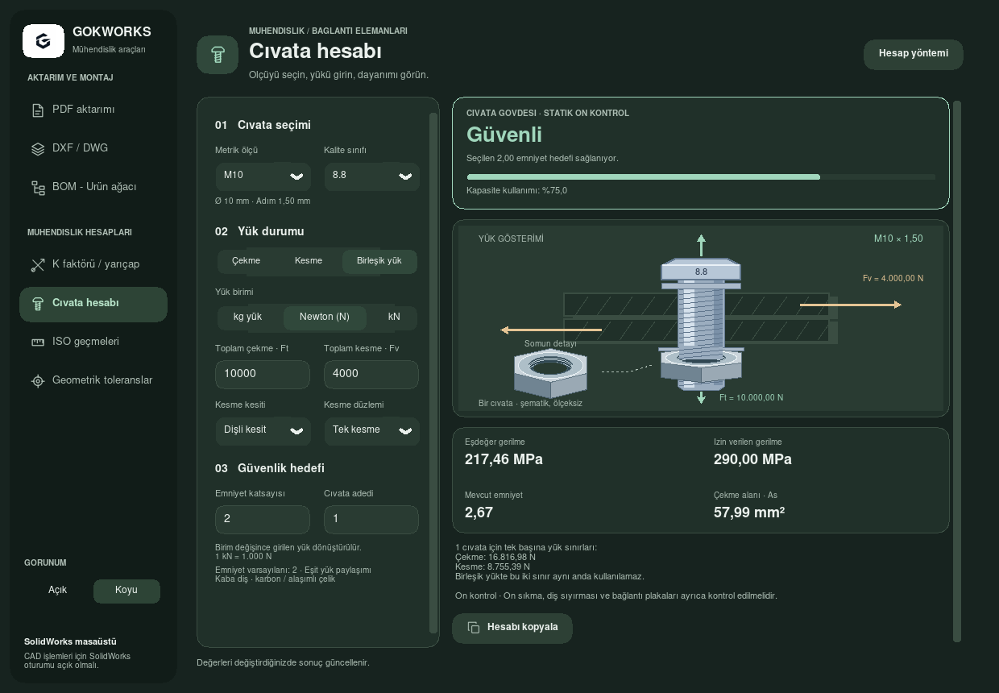

# Cıvata hesabı

**Mühendislik hesapları → Cıvata hesabı**. SolidWorks bağlantısı gerektirmez. Metrik ölçü, kalite sınıfı, yük türü ve kuvvet girildiğinde sonuç canlı güncellenir. Mavi **Güvenli**, kırmızı **Güvensiz** ve yük girilmediğinde **Yük yok** gösterilir. Hatalı girişte önceki sonuç kaldırılır.

- M3–M39 arasındaki 18 kaba diş ölçüsü; 4.6, 5.6, 8.8, 10.9 ve 12.9 çelik cıvata sınıfları.
- Çekme, kesme veya eşzamanlı birleşik yük. **kg yük / Newton (N) / kN** seçimi açılır listeden yapılır. Birim değişikliği girilmiş yükü dönüştürür; kapasite, yük okları ve pano aynı birimi kullanır. kg yük seçiminde kütle standart yerçekimi ile kuvvete çevrilir: **1 kg yük = 9,80665 N**. Önceki kgf tercihleri aynı kuvvet korunarak kg yük seçimine taşınır.
- Cıvata adedi, tek/çift kesme düzlemi, dişli/dişsiz kesit ve 1–10 arasında emniyet katsayısı. Varsayılan katsayı 2; tüm cıvatalar ve çift kesmedeki düzlemler eşit yük taşır.
- Yük okları, kapasite kullanımı, eşdeğer/izin verilen gerilme, mevcut emniyet ve çekme alanı. Hesap varsayımlarıyla panoya kopyalanabilir. Seçimler kaydedilir.
- Seçili emniyet hedefine göre yük marjı ve eşit yük paylaşımıyla gerekli en az cıvata adedi. Birleşik yükte mevcut diğer kuvvet sabitken toplam çekme/kesme sınırları. Adet otomatik değiştirilmez; gereksinim 1000'i aşıyorsa giriş sınırı belirtilir. Yük yoksa marj/adet önerisi verilmez.
- Somun altıgen yüzeyler, pah ve iç dişlerle çizilir. Büyütülmüş somun detayı açık deliği gösterir; montaj görünümünde dişli cıvata ucu somundan dışarı uzanır. Görsel ölçeksizdir, bir somun ölçü standardını doğrulamaz.

Sol sütunda parametreler ve kısa teknik bilgi, sağda mavi yük sınırı kartı, sonuç ve dinamik cıvata çizimi bulunur. Kart seçilen adet, emniyet katsayısı ve yük birimini kullanır. Birleşik yükte kart kapasite kullanımını gösterir; bağımsız çekme/kesme sınırları birlikte kullanılabilecek değerler değildir.

**Ölçüler** görünümü metrik seçimine göre `d` (nominal çap), `k` (nominal baş yüksekliği), `s` (anahtar ağzı) ve yaklaşık kılavuz deliğini günceller. Baş tablosu ISO 4017 nominal ölçülerini esas alır; DIN 933 ölçüleriyle karıştırılmaz (örneğin ISO M10 anahtar ağzı 16 mm'dir). Cıvata boyu temsili, toleranslar kapsam dışıdır. Yaklaşık `d − P` bir kılavuz deliği ön bilgisidir; bağlantı boşluk deliği ya da kesin matkap seçimi değildir. GitHub geometri tablolarıyla yapılan karşılaştırma ve sürüm farkları [cıvata referans notunda](../bolt/README.md) açıklanır; referans standardı [ISO 4017](https://www.iso.org/obp/ui/#iso:std:iso:4017:ed-5:v1:en).

**Yük gösterimi** seçeneği önceki tek başlı cıvata, somun ve çekme/kesme oklarını korur. Güncel gerçek Tk ekranları: [Koyu](../bolt/examples/bolt-dimensions-dark.png) · [Açık](../bolt/examples/bolt-dimensions-light.png).

14 Ekim arayüz revizyonunda **14 ilgili kontrol geçti**: 8 hesap, 4 gerçek Tk
ve 2 ölçü verisi kontrolü. Açık/koyu temada 1240×860 ekran görüntüleri referans
düzenle karşılaştırıldı; ölçü çizimi bu boyutta ilk görünümde tamamen açıktır.
Küçük pencerede çizime ve girişlere sütun kaydırmalarıyla ulaşılır. Kapasite,
birim dönüşümü, birleşik yük, geçersiz giriş ve sayfa önbelleği de kontrol edildi.

GitHub referanslarıyla yapılan hesap iyileştirmesinde **20 ilgili kontrol geçti**:
12 hesap, 6 gerçek Tk ve 2 ölçü verisi kontrolü. Minimum adedin güvenli sonucu
sağlaması ve bir eksik adedin sınırı aşması, tam sayı sınırları, 1000 üzeri
gereksinim, yük marjı, eşzamanlı kapasite, kg/N/kN dönüşümü ve geçersiz girişte
önceki önerinin temizlenmesi doğrulandı. Açık/koyu gerçek ekran görüntüleri
güncellendi; tüm uygulama testleri veya EXE derlemesi çalıştırılmadı.

## Hesap yöntemi

`d` nominal çap, `P` adım (mm); kuvvetler N, alanlar mm², gerilmeler MPa (= N/mm²). `n` cıvata adedi, `m` kesme düzlemi adedi, `s` hedef emniyet katsayısıdır.

```text
Çekme alanı As = π/4 × (d − 0,938194P)²
Dişli kesmede Ak = π/4 × (d − 1,226869P)²
Dişsiz kesmede Ak = πd²/4
σ = Ft / (n As)
τ = Fv / (n m Ak)
σeş = √(σ² + 3τ²)
İzin verilen gerilme = Sp / s
Kullanım = σeş / (Sp / s)
Mevcut emniyet = Sp / σeş
Güvenli koşulu: kullanım ≤ 1
Yük marjı = 1/kullanım − 1 (yük varsa)
Gerekli adet = yukarı yuvarla(√[(Ft/As)² + 3(Fv/(m Ak))²] / (Sp/s))
Mevcut Fv sabitken toplam Ft sınırı = n As √[(Sp/s)² − 3τ²]
Mevcut Ft sabitken toplam Fv sınırı = n m Ak/√3 × √[(Sp/s)² − σ²]
```

Gerekli adet en az 1'dir ve sınırdaki tam sayılar mevcut güvenli/güvensiz hesabıyla karşılaştırılır. Diğer kuvvet tek başına sınırı aşmışsa birleşik yük için geçerli sınır yoktur. Bu sınırlar eklenebilecek yük değildir ve aynı anda kullanılabilecek yeni bir yük çifti oluşturmaz. Marj, seçili deney yükü gerilmesi/emniyet sınırına göredir; akma veya kopma marjı değildir.

Deney yükü gerilmesi `Sp`:

| Sınıf | Sp (MPa) |
| --- | ---: |
| 4.6 | 225 |
| 5.6 | 280 |
| 8.8, d ≤ 16 mm | 580 |
| 8.8, d > 16 mm | 600 |
| 10.9 | 830 |
| 12.9 | 970 |

Malzeme değerlerinin dayanağı ISO 898-1:2013 deney yükü gerilmesi tablosu; kaba diş adımları ISO 261, temel diş geometrisi ISO 68-1 / ISO 724'tür. Sp kopma dayanımı değildir. Von Mises gerilmesinin Sp/s ile karşılaştırılması bu uygulamanın ihtiyatlı statik ön kontrol yöntemidir; ISO 898-1 bir bağlantı tasarım standardı değildir. Dişli kesmede çekme alanından daha küçük olan temel diş kök alanı kullanılır; imalat toleransları ayrıca modellenmez.

Referans erişimleri: [ISO 898-1](https://www.iso.org/obp/ui/#iso:std:iso:898:-1:ed-5:v1:en), [ISO 261](https://www.iso.org/obp/ui/#iso:std:iso:261:ed-2:v1:en), [ISO 724](https://www.iso.org/obp/ui/#iso:std:iso:724:ed-2:v1:en). Standartların tam metni depoya dahil değildir. Önceki revizyonda dış teknik tablo erişimi reddedilmişti. 14 Ekim GitHub incelemesinde BAT, ranf_thread_fast ve bolt-analysis kaynakları okunarak hesap varsayımları karşılaştırıldı; bu karşılaştırma tam bir VDI/ECSS/NASA bağlantı analizi veya standart doğrulaması değildir. [İncelenen sürümler ve uygulanan iyileştirmeler](../bolt/README.md).

## Kapsam

Bu ekran **cıvata gövdesinin statik ön kontrolünü** yapar. Tam yük taşıma kapasitesine sahip, ilgili sınıfa uygun karbon/alaşımlı çelik cıvata ve oda sıcaklığı kabul edilir. Paslanmaz A2/A4, ince diş, azaltılmış baş/gövde ve özel bağlantı elemanları kapsam dışıdır.

Girilen çekme kuvveti cıvataların taşıdığı toplam kuvvettir. Ön sıkmalı bağlantıda dış kuvvet doğrudan bu alana girilmemelidir; ön yük ve bağlantı rijitliği ayrıca hesaplanır. Ön sıkma, diş sıyırması, plaka ezilmesi, kenar yırtılması, kayma/sürtünme, eğilme, eksantriklik, yorulma, darbe ve sıcaklık etkileri hesaplanmaz. Güvenli sonucu bağlantının bütün bu kontrolleri geçtiği anlamına gelmez. Seçilen emniyet katsayısı uygulama gereksinimine göre belirlenmelidir.

Ekrandaki çekme/kesme kapasiteleri tek başına etkiyen kuvvetler içindir; birleşik yükte ikisi aynı anda sınır değerlerinde kullanılamaz. Kuvvet dağılımı ve kapasiteye esas kesit **Hesap yöntemi** penceresinde açıklanır.

## Kontrol örnekleri ve görseller

M10 × 1,5 / 8.8 / 1 cıvata / s=2: As ≈ 57,99 mm², Sp=580 MPa, izin verilen gerilme=290 MPa. Yalnız 10 kN çekmede σ ≈ 172,44 MPa ve sonuç güvenlidir; yalnız çekme kapasitesi ≈ 16,82 kN'dir. Diş kökü alanı ≈ 52,29 mm²; tek kesmede 10 kN güvensiz, çift kesmede güvenlidir. 12 kN çekme ve 8 kN kesme ayrı ayrı güvenliyken birlikte σeş ≈ 336,21 MPa ile güvensizdir.

14 hedefli kontrol: 8 hesap testi, 3 gerçek Tk arayüz testi ve 3 sayfa ön yükleme/tema/ölçek testi. Birim dönüşümü, sınırın iki tarafı, geçersiz/sıfır yükler, yeniden açılış, seçimlerin korunması, küçük pencere, tema ve %125 ölçek kapsandı. Linux/Python 3.13/Tk 8.6 kullanıldı; Windows/SolidWorks çalıştırılmadı. [Test çıktısı](reports/bolt/test-run.log).

[Açık tema](reports/bolt/screenshots/tension-light.png) · [Birleşik yük, koyu tema](reports/bolt/screenshots/combined-dark.png) · [1000×690, güvensiz sonuç](reports/bolt/screenshots/unsafe-dark-small.png)



Görseller çalışan Tk uygulamasından `docs/report-tools/capture_bolt_gui.py` ile alınır; hesaplar örnek girdilerle çalışır. Ek bağımlılık kurulması gerekmez.
