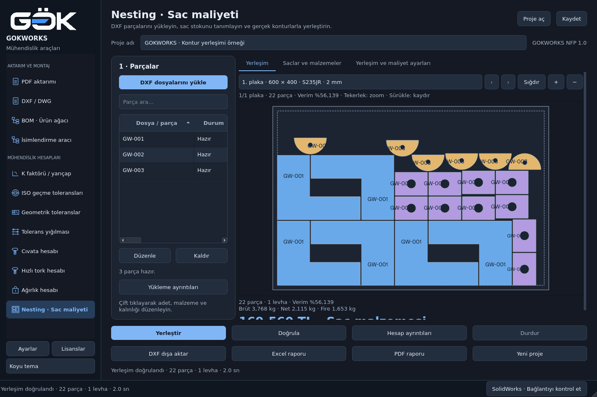
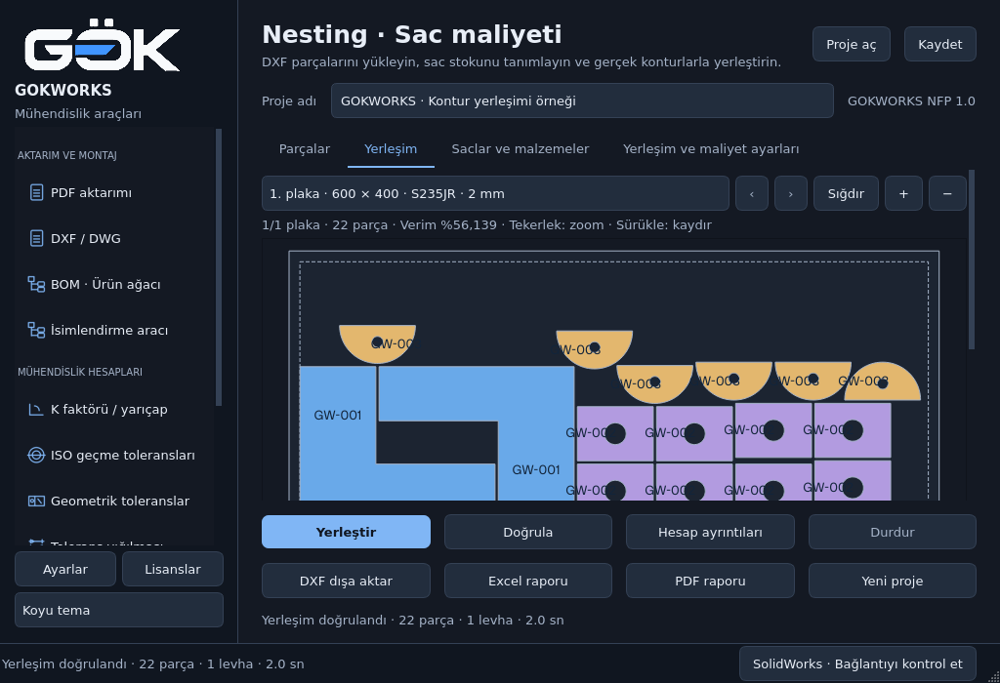
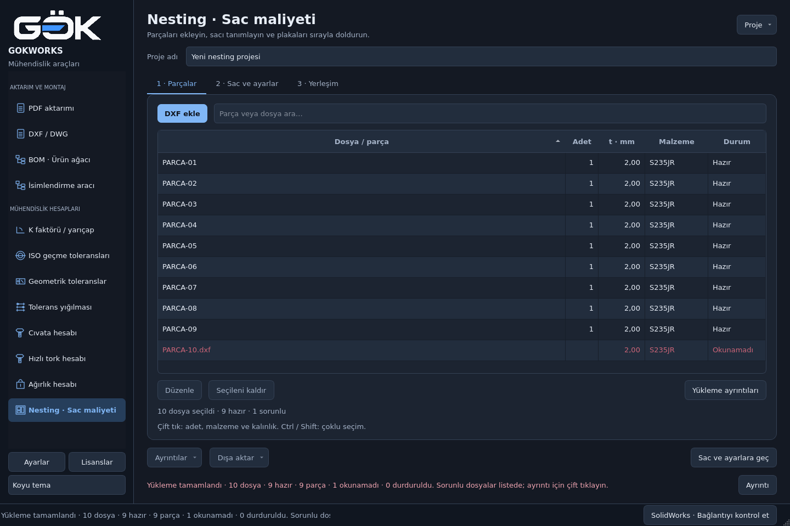
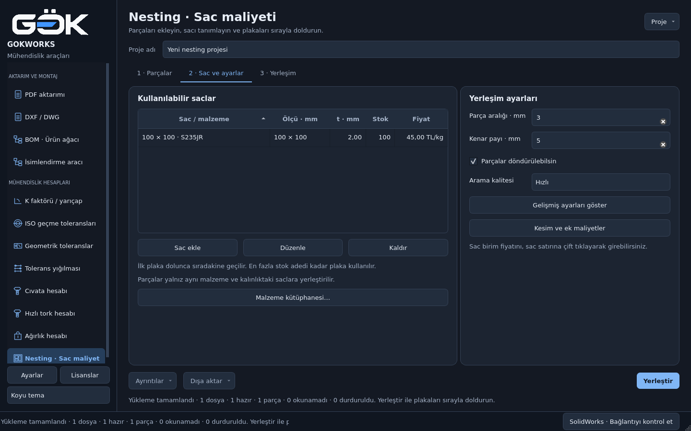
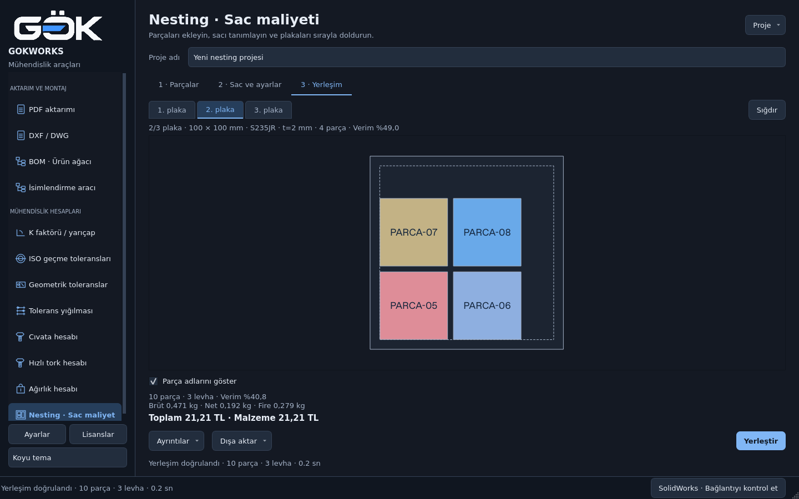
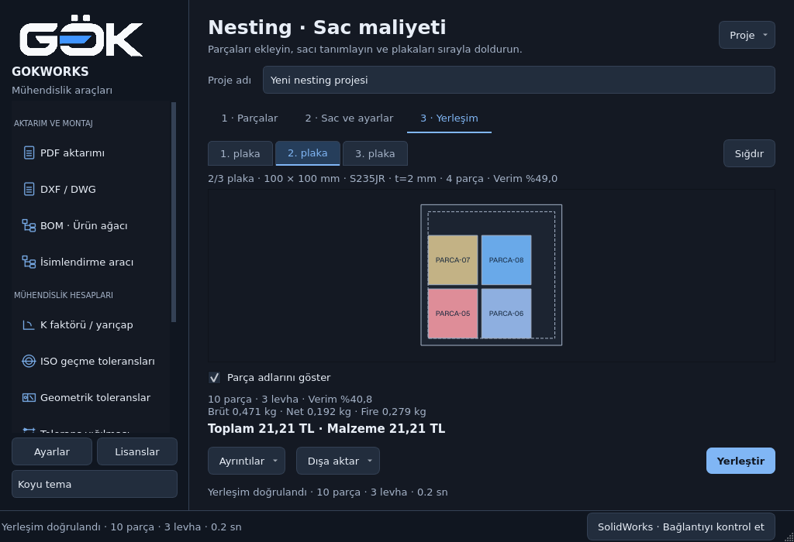
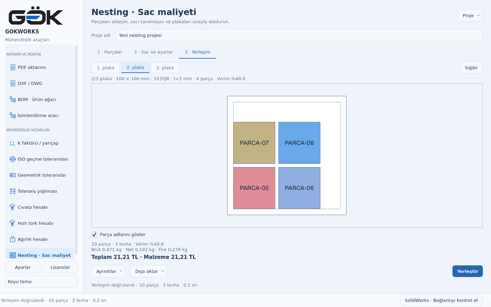

# Nesting · sade iş akışı ve plaka sekmeleri

20 Ekim 2026. Güncel çalışma dizinindeki gerçek PySide6 ekranları incelendi;
Nesting'in dosya okuma, yerleşim ve rapor akışları çalıştırıldı. Yeni bağımlılık yok.

## Önceki ekranda bulunan sorunlar

Parça listesi dar panelde kaldığı için adet/kalınlık ve açıklamalar yatay
kaydırmanın arkasındaydı. Yerleşim alanının dışındaki scroll, sığdırılmış
plakayı ve maliyet özetini küçük pencerede kesiyordu. Malzeme kütüphanesi,
stok ve gelişmiş ayarlar temel akışı kalabalıklaştırıyordu.




Etkileşim/kod incelemesinde, eksik yerleşim için çıktı düğmelerinin açık
kalması, kaldırmanın yalnız tek satırı işlemesi ve sonuç kartında operasyon,
kâr/KDV yerine yalnız malzeme bedeli gösterilmesi de tespit edildi.

## Kontrol edilen akış

1. **Parçalar — düzeltildi.** Tam genişlikte arama ve tablo; adet, kalınlık,
   malzeme ve durum görünür. Sayılar sağa hizalıdır. Ctrl/Shift ile çoklu
   kaldırma, sıralama ve filtreyle birlikte doğru kimlikleri işler. Tam yol,
   okuma hatası ve net kg/adet tooltip içinde; ayrıntılı geometri editördedir.
   On gerçek DXF'in biri bilerek bozuldu: dokuzu yüklendi, hatalı dosya
   kaybolmadı ve yeniden denemeyle tamamlandı.

   

2. **Sac ve ayarlar — sadeleştirildi.** Stok ve temel yerleşim ayarları aynı
   adımda. Gelişmiş ayarlar ve ek maliyetler açılıp kapanır; kapatmak değerleri
   sıfırlamaz. Kaydedilmiş ek maliyetler projeyi açınca görünür. Malzeme
   kütüphanesi ayrı bir pencerededir; düzenleme işlevleri korunur.

   

3. **Yerleşim — düzeltildi.** AutoCAD benzeri belge sekmeleriyle her fiziksel
   plaka ayrı seçilir. Sekmeler tıklama ve klavye sol/sağ oklarıyla çalışır;
   taşınca kaydırma düğmeleri görünür. On parça gerçek motorla **4 + 4 + 2**
   olarak üç plakaya yerleştirildi. Malzeme/kalınlıkları farklı stokların kendi
   “1. plakaları” da birbirinden ayrı kimliklerle gösterilir.

   

4. **Küçük pencere ve tema — kontrol edildi.** Sekme sırası sabittir;
   önizleme, alt özet ve düğmeler birbirinin üstüne gelmez. Uzun parça adları
   kısaltılır; tam ad tooltip'tedir. Adlar konturları yeniden kurmadan
   açılıp kapatılır. 20 plakalı dar pencere senaryosunda son sekmeye ulaşılır.

   
   

5. **Sonuç ve çıktı — düzeltildi.** Genel toplam operasyonlar, kâr ve KDV'yi
   içerir; malzeme bedeli ayrıca gösterilir. Sıfır sac fiyatı “Sac fiyatı eksik”,
   eksik yerleşim “Kısmi hesap” olarak işaretlenir. Eksik yerleşimde DXF,
   Excel ve PDF hem arayüzde hem işlem girişinde engellenir; JSON proje
   kaydedilebilir. Fiyat güncellemesi koordinatları ve seçili plakayı korur.
   Proje açılırken maliyet doğrulaması worker üzerinde yapılır; ayrıntı
   penceresi hazır hesapları kullanır. Görsel kanıt: 3. ve 4. adım.

## Doğrulama ve sınırlar

**74 Nesting motor/Qt testi geçti.** Geometri, çoklu DXF ve parser hatası,
iptal, stok, 1→2→3 plaka sırası, farklı malzeme/kalınlık, maliyet, kaydet/aç ve
gerçek DXF/Excel/PDF çıktıları kapsanır. Son küçük görünüm/tooltip düzenlemesi
için üç GUI kontrolü ayrıca tekrarlandı. İki tema ve 1440×960, 1024×700,
820×560 boyutlarında sıralama, erişim, taşma/örtüşme denetlendi.
Ana uygulamanın **12 modül / 2 tema / 4 çözünürlük** kaynak açılış kontrolü geçti.

Erişilebilirlik açısından sayısal hizalama, tooltip, klavye ile plaka seçimi
ve görünür denetimlerin yerleşimi kontrol edildi. Ekran okuyucu veya Windows
yüksek kontrast testi yapılmadı; tam erişilebilirlik uyumluluğu iddia edilmez.
Görüntüler Linux Qt/offscreen üzerinde alındı. Kullanıcının gerçek CAD dosyaları,
Windows EXE ve üretim tezgâhı bu kontrolün parçası değildir. Nesting SolidWorks
gerektirmez. NFP motoru sezgiseldir; matematiksel optimum garantisi yoktur.
Bu güncelleme için EXE üretilmedi.

- [Test kaydı](checks.json) · [Gerçek yakalama kaydı](capture.json)
- [Yakalama betiği](../report-tools/capture_nesting_usability.py)
- [Kullanım ve hesap ayrıntıları](../../modules/nesting/README.md)

```bash
QT_QPA_PLATFORM=offscreen python -m pytest modules/nesting/tests/test_nesting.py modules/nesting/tests/test_nesting_gui.py -q
QT_QPA_PLATFORM=offscreen python docs/report-tools/capture_nesting_usability.py
QT_QPA_PLATFORM=offscreen python main.py --self-check /tmp/nesting-source-check.json
```
