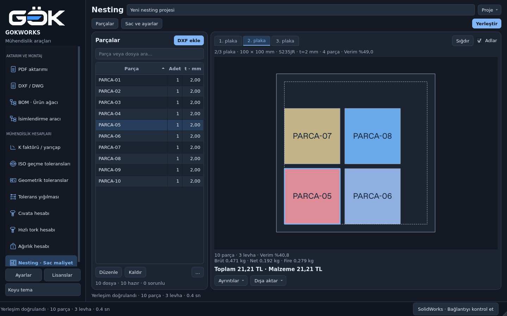

# Nesting: parçalar ve yerleşim birlikte

Product Design incelemesi; gerçek PySide6 ekranları ve mevcut tasarım sistemi
esas alınarak uygulandı. Tarayıcı prototipi veya yeni arayüz kütüphanesi yoktur.

## İncelenen akış ve sorunlar

1. Çoklu DXF yükleme → listeyi kontrol etme → sac tanımı → yerleştirme →
   fiziksel plakalar arasında geçiş → çıktı. Başlangıç ekranı:
   [önce](00-before.png).
2. **Yüksek öncelik:** liste ve çizim ayrı sekmelerdeydi; parçayı yerleşimle
   karşılaştırmak ekran değiştirmeyi gerektiriyordu. İkisi artık aynı alanda.
3. **Orta öncelik:** büyük başlık, proje satırı, adım sekmeleri ve tekrar eden
   açıklamalar çizim alanını daraltıyordu. Proje adı başlığa taşındı; gereksiz
   adım sekmeleri kaldırıldı, ayarlar tek pencerede toplandı.
4. **Orta öncelik:** çizimdeki parçayı listede bulmak zordu. İki yönlü seçim,
   bütün örnekleri belirginleştirme ve sıralama/filtreye rağmen kimlikle eşleme eklendi.
5. **Orta öncelik:** dar ekranda çok sayıda tablo sütunu kullanışsızdı. Parça,
   adet ve kalınlık korunur; kaynak, malzeme ve durum ipucunda/özelliklerde,
   başarısız yüklemeler ayrıca satır adında ve yükleme ayrıntılarında gösterilir.

## Güncel ekranlar

- [Açık tema](04-plates-light.png)
- [1024 × 700](05-plates-small.png)
- [820 × 560 minimum pencere](06-plates-minimum.png)
- [Liste kapalı, çizim odakta](07-drawing-focus.png)
- [Sac ve ayarlar penceresi](02-stock-dark.png)
- [Başarısız DXF de listede kalır](01-parts-dark.png)

Üstte **Yerleştir**, solda yeniden boyutlandırılabilir parça listesi, sağda
mevcut AutoCAD tarzı fiziksel plaka sekmeleri ve geniş çizim vardır.
**Sac ve ayarlar** stok, yerleşim ve maliyet alanlarını açar. Gelişmiş alanlar
varsayılan kapalıdır. Kapatma değerleri sıfırlamaz; düzenlemeler canlı uygulanır.
Fiyat güncellemesi seçili fiziksel plakayı ve yerleşim koordinatlarını korur.

## Doğrulama

- On gerçek üretilmiş DXF, üretim içe aktarıcısı ve NFP motoru kullanıldı.
  Bir bozuk dosya görünür kaldı, yeniden okundu; sonuç **4 + 4 + 2** parça ile
  üç fiziksel plakaya yerleşti. Sonuç bağımsız geometri doğrulamasından geçti.
  [Yakalama kaydı](capture.json), [tekrar üretme betiği](../report-tools/capture_nesting_usability.py).
- `tests/test_nesting_gui.py`: **24 test başarılı**. İki tema, minimum boyut,
  listeyi gizle/göster, ayarları aç/kapat, seçim eşleme, sürükleme, manuel zoom,
  20 plaka, çoklu yükleme/kaldırma, iptal, kısmi sonuçta çıktı kilidi ve maliyet
  güncellemeleri denendi. Taslak düzenleme penceresi açıkken maliyet
  güncellemesi bekler ve pencere kapatılınca devam eder.
- `tests/test_nesting.py tests/test_qt_workflows.py`: **191 test başarılı**.
  PDF'nin üç yeni testi de geçti; toplam **218 ayrı test** doğrulandı.
  [Kaynak uygulama açılış kontrolü](selfcheck.json): 12 modül, iki tema ve dört
  çözünürlük geçti. Bu makinede ölçülen geçiş ortancası 15,47 ms, yeniden
  boyutlandırma ortancası 8,76 ms'dir; Windows performans garantisi değildir.
- PDF okunabilirliği ve bağlantı düzeltmesi için
  [ayrı inceleme ve örnek rapor](../nesting-pdf-readability/README.md).
- Kontrollerin erişilebilir adları, klavye ile plaka geçişi, gerçek tablo
  seçim modeli ve hata metinleri korundu. Ekran okuyucuyla gerçek Windows
  oturumunda denenmedi; tam erişilebilirlik uygunluğu iddia edilmez.
- Bu ekran görüntüleri Linux/offscreen Qt kaynağından alındı. Windows DPI ve
  tek EXE kontrolleri sonraki istenen Windows derlemesinde çalıştırılmalıdır.
  Bu değişiklik için EXE üretilmedi; mevcut EXE güncellenmiş sayılmaz.

Diğer modüllerin arayüzü ve NFP geometrisi değiştirilmedi. Yeni bağımlılık yoktur.
