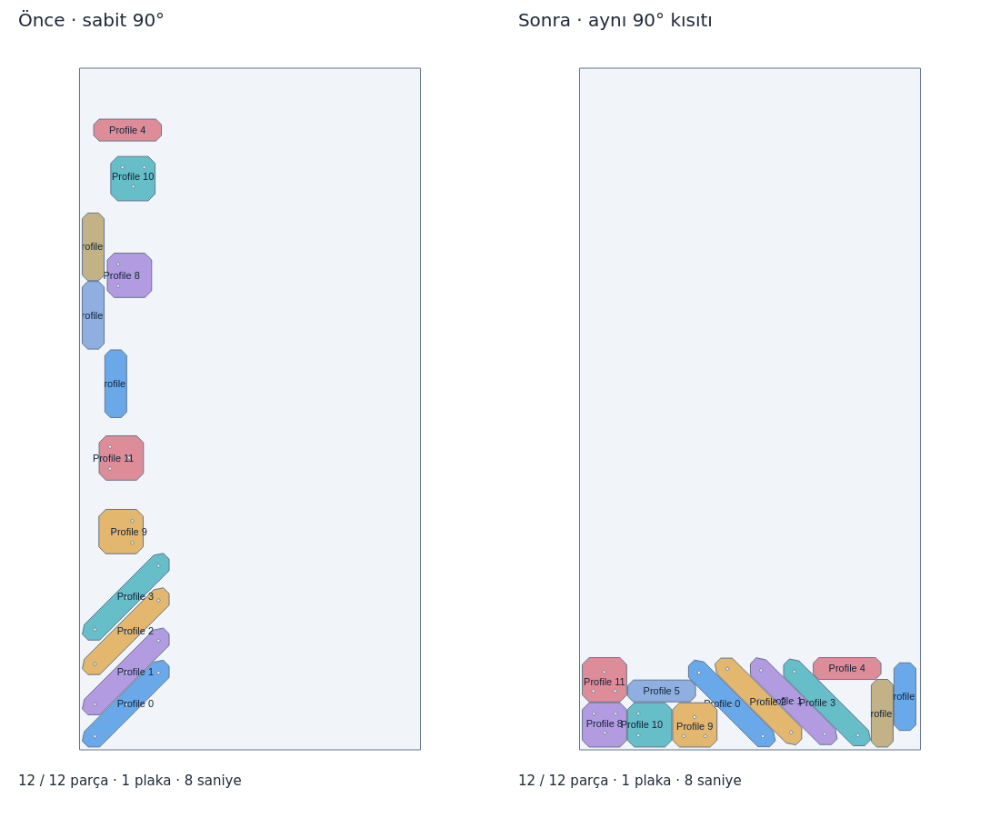

# Nesting çekirdeği ve sıkıştırma güncellemesi

Gönderilen `nestsp.exe` dosyasındaki semboller Sparrow optimizasyonu ve jagua-rs
geometri çekirdeğini gösterir. Dosya SHA256:
`8aa588778ce5034403ad3a0525e725ac810873473ae438b8e7a1298e79dfb5d4`.
EXE çalıştırılmadı veya dağıtıma kopyalanmadı. Bulunan Nestra deposu
[webalet/nestra-surumler](https://github.com/webalet/nestra-surumler) dağıtım
sayfasıdır; uygulamaya özel kaynak kodu ve açık kaynak lisansı içermiyor.
Dolayısıyla bu çalışma Nestra'nın tüm ek algoritmalarının birebir aktarımı değildir.

Kullanılan açık çekirdekler:

- [spyrrow 0.10.0, f6345979](https://github.com/PaulDL-RS/spyrrow/tree/f6345979e5f6cf88e9e2e3775750fcce899334fd), MIT.
- [Sparrow 0.3.0, 3be91585](https://github.com/JeroenGar/sparrow/tree/3be915856b543d18c9cb7d4664fe7c53901fe1fd), MIT.
- [jagua-rs 1.0.0](https://crates.io/crates/jagua-rs/1.0.0), MPL-2.0.

Eski Python wheel'i spyrrow 0.9.0 / Sparrow 0.1.0 / jagua-rs 0.7.0 içeriyordu.
Yeni bağlantı henüz PyPI wheel'i olmadığından değişmez kaynak revizyonundan,
Cargo.lock korunarak derlenir. Geliştirici ortamında Python 3.13, Git ve Rust
1.90+ gerekir. Windows CI, Rust 1.90.0 kurar; kullanıcıya verilen EXE native
kütüphaneyi içerir. Kullanıcıdan Rust kurulumu beklenmez. Lisans metinleri,
kilit dosyası, bağımlılık envanteri, SBOM ve değiştirilmemiş jagua kaynak arşivi
[dağıtım klasöründedir](../../packaging/licenses/nesting/sparrow/OKU.txt).

## Davranış

Yeni arayüz projeleri serbest dönüşle başlar. `90° adımlı` ve `Özel açılar`
seçenekleri vardır. Eski kayıtlardaki açı listesi aynen korunur; `angles: null`
serbest dönüş demektir. Hadde kilidi serbest dönüşte de yalnız 0°/180° kabul
eder; döndürme kapalıysa yalnız 0° geçerlidir. Aynalama kullanılmaz.

Sparrow başlangıç yerleşimini üretir; GOKWORKS NFP aynı sonucu delik içi
kullanım, plaka boşaltma ve sıkıştırmayla iyileştirir. Native motor artık
plakanın her iki ekseninde şerit sıkıştırmayı dener, en fazla dört CPU işçisi
kullanır ve ortak süre bütçesinin daha büyük bölümünü alır. NFP adayları da
kaplanan şerit ve kutu alanını küçültmeye göre sıralanır. Entegre akışta
`bir plakaya sığdı` sonucu tek başına sıkıştırmayı erken bitirmez; süre ve
iyileşme durma ölçütleri işlemeye devam eder.

Karşılaştırma sırası: yerleşmeyen adet, plaka adedi, toplam sac alanı, kaplanan
şerit alanı. Şerit ölçüsü `min(sac boyu × en sağ kenar, sac eni × en üst kenar)`
olarak fiziksel mm koordinatlarında hesaplanır; iki kesim yönünden daha büyük
kullanılabilir artık sac bırakanı tercih eder. Sonuç başlangıç çözümünden
kötüleşmez. Bu ölçü net parça alanı/sac alanı verim yüzdesinden farklıdır.

Her çözüm özgün konturlarla, mm biriminde ayrıca kontrol edilir: çakışma,
parça aralığı, kerf, kenar payı, malzeme, kalınlık, stok, adet, açı ve parça
kimliği. Native strip'e sığmayacak serbest dönen parçalar minimum kaliper
genişliğiyle elenir; kontur büyütülmez, küçültülmez veya dışbükey zarfla
kesim geometrisi değiştirilmez. Zaman aşımı/iptal çalışan yardımcı süreci
sonlandırır; son geçerli çözüm korunur.

## Tekrarlanabilir karşılaştırma

Bu örnek kullanıcı ekranındaki PLATFORM_ENC_91 dosyası değildir; o işin
kaynak CAD/proje dosyası elde yok. `reproduce.py`, delikli ve farklı CAD yönlü
12 özgün profil üretir. Sac 1250×2500×8 mm; aralık 3 mm, kenar 10 mm,
kerf 0.2 mm, Yüksek kalite ve toplam 8 saniye bütün koşullarda aynıdır.

| Ölçü | Önce, 90° | Sonra, aynı 90° | Sonra, serbest |
|---|---:|---:|---:|
| Yerleşen | 12/12 | 12/12 | 12/12 |
| Plaka | 1 | 1 | 1 |
| Şerit alanı, mm² | 821.083 | 422.770 | 422.794 |
| Parçaları çevreleyen kutu, mm² | 732.947 | 401.131 | 403.524 |
| Ölçülen süre, sn | 8,16 | 8,02 | 8,02 |

Aynı 90° kısıtında şerit alanı %48,5 azalır. Bu örnekte serbest dönüş daha iyi
bir sonuç vaat etmez; parçaya ve bütçeye göre sonuç değişir. Her iki ekseni
deneme ve sıkıştırma hedefi bu örnekte asıl kazanımı verir. Üç sonuç da
bağımsız geometri doğrulamasından geçmiştir. Ham kayıtlar: [önce](before.json),
[aynı açı kısıtı](after-restricted.json), [serbest](after-free.json).



```sh
python -m pip install -r requirements-dev.txt
python docs/nestsp-core/reproduce.py /tmp/nesting-restricted
python docs/nestsp-core/reproduce.py /tmp/nesting-free free
python -m pytest modules/nesting/tests modules/smart_splitting/tests tests/test_nesting_native_sources.py
```

Temel karşılaştırma: agent/codex `0b9d3b2`, spyrrow 0.9.0. Ölçümler Linux
x86_64 üzerinde yapıldı; native CPU araması farklı makinelerde aynı koordinatları
üretmek zorunda değildir. Gerçek PLATFORM işi için aynı parçalar, adetler,
malzeme/kalınlık, sac, aralık ve süreyle ayrıca karşılaştırma gerekir.

## Kullanıcının gerçek çerçeveli çizimi

Daha önce yüklenen `Redry_Support_5mm_2adet.dxf` içe aktarma kaydıyla ayrıca
14 parça türü / 56 adet denendi. Çok plakalı bir işte başlangıç bütçesinin
ilk şeritte tükenmesini önlemek için kalan dış kontur alanından tahmini plaka
sayısı hesaplanır ve süre kalan fiziksel plakalara paylaştırılır. Bu tahmin
bir sığma kararı değildir; yalnız arama süresini dağıtır.

Serbest dönüşle hem 12 saniye hem 15 saniye toplam bütçede 56/56 parça,
3 plaka ve bağımsız geometrik doğrulama elde edildi. [15 saniye kaydı](actual-redry.json).
Bu dosyada eski kaydın da 3 plaka kullandığı ve net malzeme veriminin değişmediği
özellikle korunmalıdır; bir plaka azaltımı iddiası yoktur.

Farklı malzeme/kalınlık grupları da aynı toplam bütçeyi paylaşır. Bir grubun
başarılı başlangıcı bulunduğunda yalnız o gruba uygun alternatif saclar
karşılaştırılır; diğer bekleyen gruplar için en az bir başlangıç dilimi ayrılır.
Dört malzeme ve dört kalınlık grubu ayrı kontrollü saat testleriyle doğrulandı.
Gerçek native motorla dört kalınlık grubundaki 12/12 parça, 12 saniyelik
bütçede 11,45 saniyede dört uygun saca yerleşti ve geometri kontrolünden geçti.
