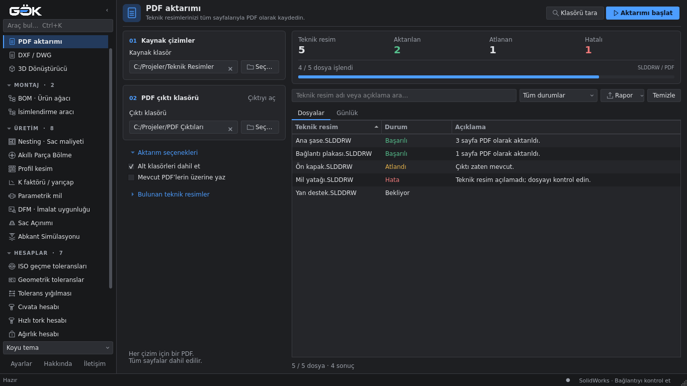
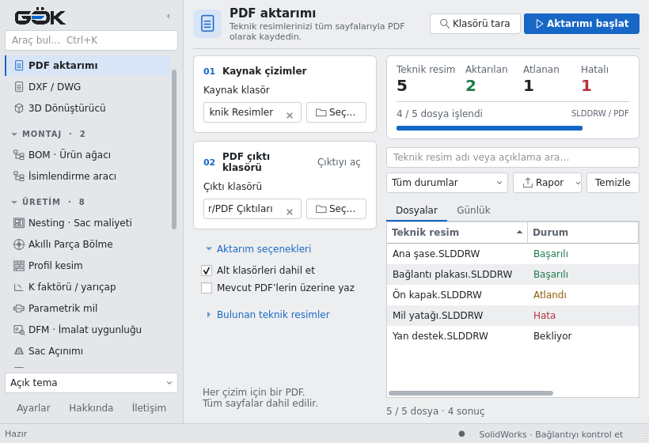

# PDF aktarımı arayüzü · 11 Kasım 2026

Kaynak ve çıktı alanları, canlı sonuç özeti, dosya adları ve başlangıç durumu
yenilendi. Mevcut Qt modelleri, ayar anahtarları ve aktarım komutları kullanılır.
Ekrandaki sonuçlar görsel kontrol için örnek verilerdir; gerçek CAD aktarımı değildir.

Kontrol edilen durumlar: boş liste, örnek dosyalar, başarılı/atlanan/hatalı/kısmi
sonuç, filtrede eşleşme olmaması, çalışırken kilitlenen komutlar, ilerleme,
rapor, iki tema ve küçük/geniş pencere. Yeni Qt testleri, kısa ad gösterilse de
aynı adlı iki farklı kaynak kimliğinin ve CSV'deki tam yolların korunduğunu doğrular.

`modules/pdf/exporter.py`, `modules/pdf/process.py`, `gui_qt/services.py`
dosyaları değişmemiştir. Ortak `ExportPage` içinde `validate`, `scan`,
`start_export`, `handle_events`, `export_arguments`, `prepare_export_results`
ve `set_busy` metotlarının AST karşılaştırması aynı sonucu vermiştir.
Kontrollü servis testi, aynı altı konumsal argümanın GUI dışındaki işçiye
gönderildiğini doğrular. Canlı SolidWorks testi veya yeni EXE derlemesi değildir.
