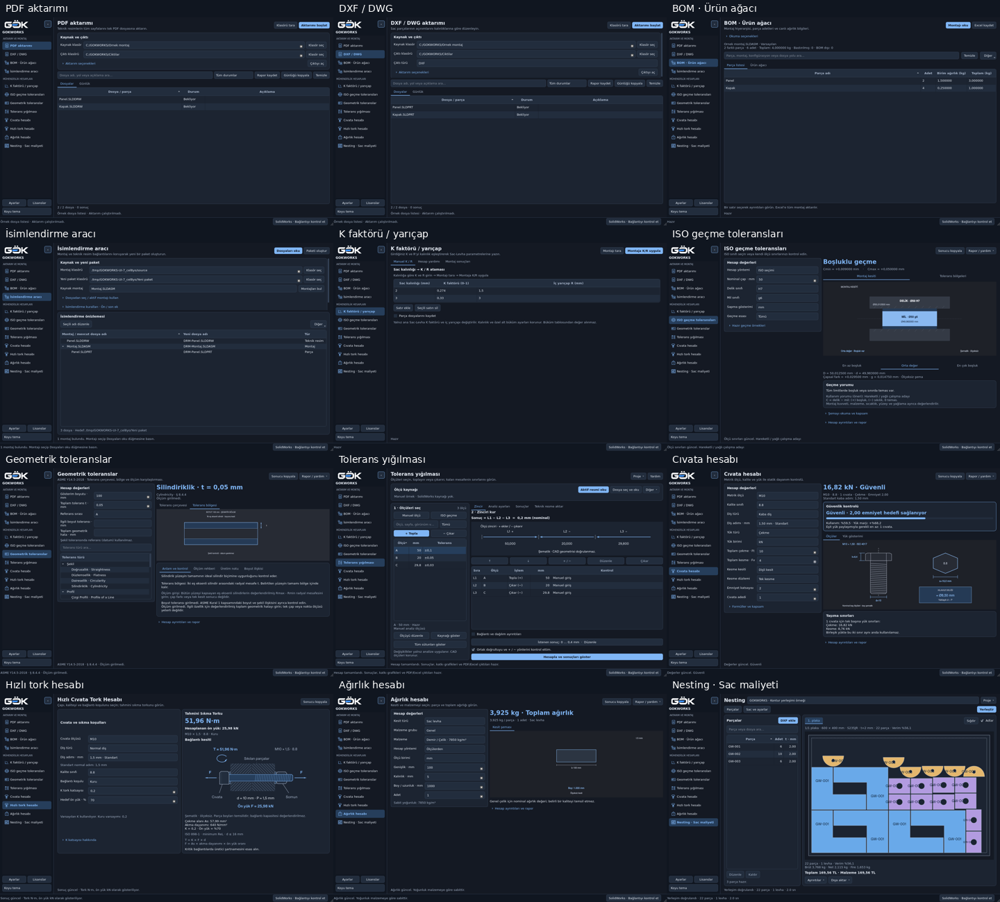

# GOKWORKS · Tüm arayüzlerin sadeleştirilmesi

20 Ekim 2026 · Product Design incelemesi ve mevcut PySide6 uygulamasına uygulanmış düzenlemeler.
Önce 12 gerçek ekran yakalandı; ardından kaynak, seçim/hesap ve sonuç akışları incelendi.
FreeCAD, Qt Creator ve PrusaSlicer'ın ilgili kaynak yapılarından tasarım örnekleri araştırıldı.
[Kaynaklar, incelenen satırlar ve lisanslar](references.md). Bu ürünlerin kodu veya görseli kopyalanmadı.

[Açık tema genel görünüm](after/overview-light.png) · [Başlangıç ekranları](before/contact-sheet.png)

## İncelenen akışlar

1. **Kaynağı veya girdiyi seçme — arayüz kontrolü geçti.** Kaynak/hedef alanları görünür;
   ana işlem üstte. İsimlendirme klasör seçimiyle başlar. Birden fazla montaj varsa
   açık seçim gerekir; görünen seçimle işlenecek dosya çelişmez.
2. **Parametreleri düzenleme ve sonucu inceleme — kontrol geçti.** Ortak kart ve form
   aralıkları küçüldü; ana yazı boyutu 13 px olarak korundu. Teknik açıklamalar silinmedi.
   Gelişmiş bölümler kapatılıp açılınca değerler ve hesap durumu korunur. Dar pencerede
   hesap sonucu, uzun form kaydırılırken üstte de görünür.
3. **Sonuç/rapor işlemleri — arayüz ve yerel çıktı kontrolleri geçti.** Liste, çizim ve
   sonuçlara daha fazla yer ayrıldı. Rapor ve yardım işlemleri küçük menülerde;
   işlem sürerken Durdur görünür. Dosya güvenliği, onaylar, kayıt anahtarları ve
   hesap motorları korunur. Gerçek SolidWorks oturumu bu ortamda çalıştırılmadı.

## Ekran bazında bulgular ve uygulanan değişiklikler

| Ekran | Başlangıç sorunu → güncel düzen | Kanıt |
| --- | --- | --- |
| PDF aktarımı | Uzun seçenek kartı → kaynak/çıktı önde; aktarım kuralları açılır bölümde; liste daha büyük. | [Önce](before/pdf.png) / [Sonra](after/pdf-dark.png) |
| DXF / DWG | Fazla sabit seçenek → çıktı türü görünür, büküm/kalınlık/üzerine yazma kuralları gerektiğinde açılır. | [Önce](before/dxf_dwg.png) / [Sonra](after/dxf_dwg-dark.png) |
| BOM | Uzun araç çubuğu ve teknik sütunlar → ana adet/ağırlık sütunları önde; ağaç ve teknik sütunlar menüden erişilir; Excel tüm veriyi korur. | [Önce](before/bom.png) / [Sonra](after/bom-dark.png) |
| İsimlendirme | Kalabalık seçim/kurallar alanı → montaj klasörü ve hedef önde; doğrudan dosya/aktif montaj ve isimlendirme kuralları ayrı açılır bölümlerde. | [Önce](before/naming.png) / [Sonra](after/naming-dark.png) |
| K / R | Birkaç satır için büyüyen boş tablo → tablo yüksekliği satır sayısına göre sınırlı; üç işlem adımı görünür. Abkant kesiti korunur. | [Önce](before/k_factor.png) / [Sonra](after/k_factor-dark.png) |
| ISO geçmeler | Aynı anda çok sayıda açıklama ve örnek → sonuç/kesit önde; hazır örnekler ve şema açıklaması açılabilir. Manuel kontrolün açıklamaları ve üç sonuç sekmesi korunur. | [Önce](before/iso_fits.png) / [Sonra](after/iso_fits-dark.png) |
| Geometrik toleranslar | Üst üste dört uzun açıklama kartı → anlam/kontrol, ölçüm rehberi, üretim notu ve boyut ilişkisi sekmeleri. Çerçeve ve bölge çizimleri korunur. | [Önce](before/geometric_tolerances.png) / [Sonra](after/geometric_tolerances-dark.png) |
| Tolerans yığılması | Yoğun başlık ve dar alanda taşan iki panel → daha kısa kaynak çubuğu; küçük pencerede ölçü listesi ayrı seçicide. Zincir, hata düzeltme ve hesap düğmesi okunur kalır. | [Önce](before/tolerance_stack.png) / [Sonra](after/tolerance_stack-dark.png) |
| Cıvata | Sürekli görünen formül ve ayrıntı tablosu → teknik bilgi/rapor açılır; güvenlik çubuğu, kapasite sınırları ve iki çizim korunur. | [Önce](before/bolt.png) / [Sonra](after/bolt-dark.png) |
| Hızlı tork | Tekrarlanan açıklamalar → K varsayımları açılır bölümde; tork, ön yük, kritik bağlantı notu ve bağlantı kesiti korunur. | [Önce](before/bolt_torque.png) / [Sonra](after/bolt_torque-dark.png) |
| Ağırlık | Sonucun altında sürekli büyük tablo → rapor açılır, kesit ve ağırlık önde; katalog alanı seçilirse ne girileceği açıklanır. Yoğunluk malzemeden gelir. | [Önce](before/weight.png) / [Sonra](after/weight-dark.png) |
| Nesting | Önceki birleşik alan korunarak ortak kompakt tasarıma uyum sağlandı. Parçalar/yerleşim aynı alanda, fiziksel plaka sekmeleri ve maliyet görünür. | [Önce](before/nesting.png) / [Sonra](after/nesting-dark.png) |

## Ortak kullanım düzeni

- Sol menü varsayılan olarak adlarıyla görünür. **‹ / ›** veya **Ctrl+B** ile
  64 px simge şeridine daraltılabilir. Tam adlar ipucunda ve erişilebilir adlarda
  korunur. Seçim ve sayfa girdileri kaybolmaz; daraltma tercihi kaydedilir.
- Kart iç boşlukları 18/16 yerine 12/10 px, form aralığı 12 yerine 8 px,
  tablo satırları 38 yerine 32 px. Başlıklar 25 yerine 21 px; ana metin küçültülmedi.
- İkincil rapor/yardım işlemleri küçük menülere taşındı. Gerekli seçimler,
  etkin hatalar ve kritik mühendislik kapsamı sonuç yanında kalır.
- Sayfalar gezinirken yeniden oluşturulmaz; COM veya hesap işleri gezinme
  sırasında başlatılmaz. Dar ekranda yeniden düzenlenen aynı widget'lar kullanılır.
- **Ayarlar** artık tema ve menü görünümünü doğrudan değiştiren bir penceredir;
  dosya/çalışma bilgileri ayrı açılabilir. [Görünüm](after/application-settings.png).

[Küçük pencere: tork](after/bolt_torque-minimum.png) ·
[Küçük pencere: zincir](after/tolerance_stack-minimum.png) ·
[Ölçü seçici](after/stack-measurement-picker.png) ·
[Daraltılmış menü](after/collapsed-navigation.png)

## Doğrulama ve sınırlar

- Geniş regresyon: **895 başarılı, 7 atlanan, 878 alt test başarılı**.
  [Çıktı](full-tests.txt). Canlı CAD/platform gerektiren testler başarılı sayılmadı.
- Son UI/isimlendirme kontrolleri: **23 başarılı**.
  [Çıktı](final-gui-tests.txt). Bunlar geniş paketle kısmen örtüşür; sayılar toplanmaz.
- Son ortak açılır bölüm değişikliği için **5 tolerans testi**, girdi kartlarının
  gereksiz yere uzamaması için **6 hesap arayüzü testi** ayrıca geçti.
- [Kaynak paket açılış kontrolü](selfcheck.json): 12 modül, iki tema, dört
  çözünürlük ve gerçek yerel DXF/NFP/Excel/PDF işlemleri geçti.
- Ek kontroller: küçük pencerede başlık düğmelerinin sınırlar içinde kalması,
  ortak açılır bölümlerin değerleri koruması, dar menüyle gezinme, tema seçimi,
  isimlendirmede çoklu montaj seçimi, K/R satır kaydı ve çizim metin sınırları.
- [Görüntüleme kaydı](after/capture.json): 1440×900 açık/koyu; 820×560 her
  modül. Tolerans örneği gerçek motorla 0,20 / 0,02 / 0,38 mm sonucunu verdi;
  nesting depodaki gerçek DXF örneğinin doğrulanmış yerleşimini kullanır.
  BOM/PDF/DXF/isimlendirme ekranındaki CAD kayıtları arayüz örneğidir;
  SolidWorks çalıştırılmış gibi raporlanmaz.
- Klavye gezinmesi, odak sınırları ve okunabilir Türkçe kontrol adları denendi.
  Görseller tam erişilebilirlik uygunluğu kanıtı değildir; ekran okuyucusu,
  gerçek Windows DPI ve canlı CAD oturumu bu ortamda denenmedi.
- Yeni GUI framework'ü veya uygulama bağımlılığı eklenmedi. Hesap, CAD bağlantı,
  PDF süreç yalıtımı ve tek EXE paketleme mekanizması değiştirilmedi.
  **Bu değişiklik için Windows EXE üretilmedi.**

Tekrar görüntülemek: `QT_QPA_PLATFORM=offscreen python
docs/report-tools/capture_compact_product.py docs/product-design-compact/after`.
Windows'ta standart Qt platformu kullanılabilir. Uygulama: `python main.py`.
