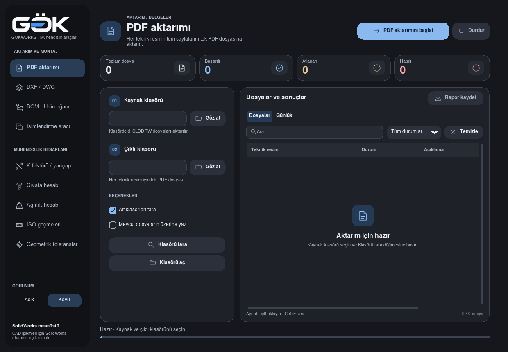
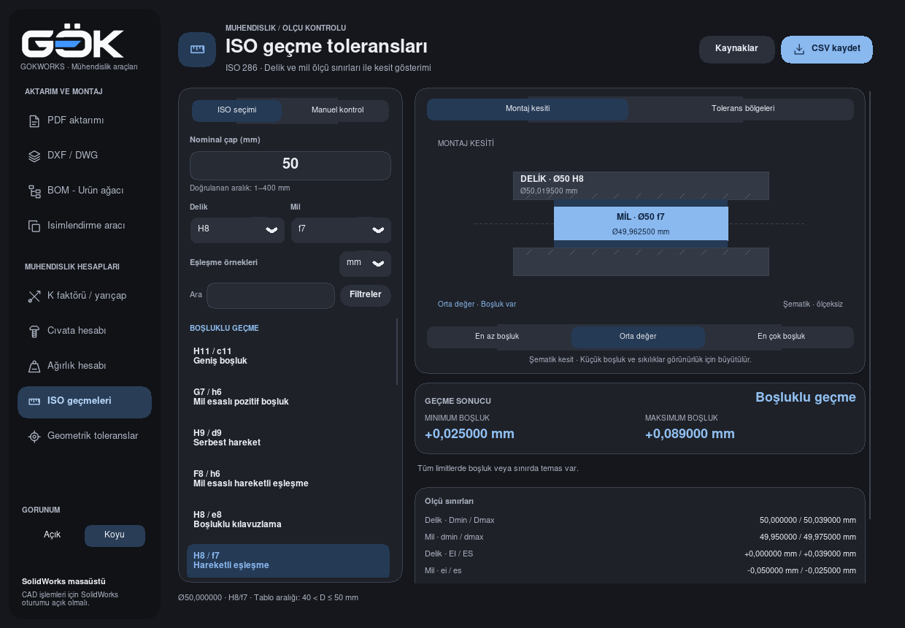
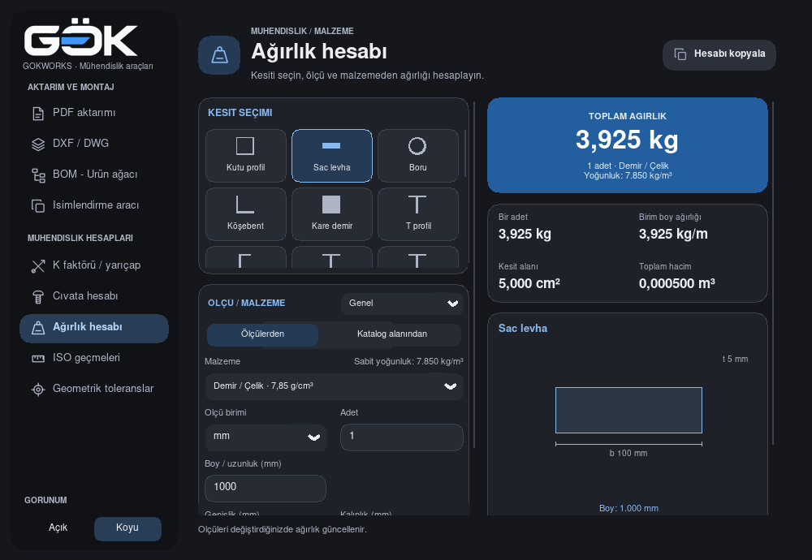
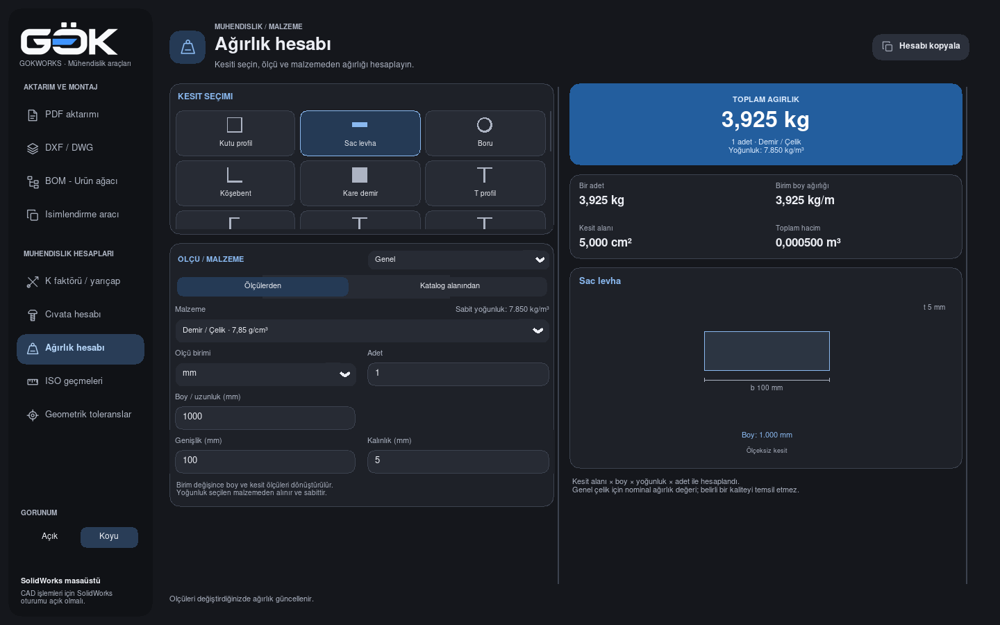

# Akıcılık incelemesi ve düzenlemeler — 17 Ekim 2026

Hedef, mevcut GOKWORKS arayüzünde menüler arasında dolaşırken ve pencere
boyutlandırırken gereksiz çizim/yerleşim işini azaltmaktı. Mevcut kaynak kodu,
gerçek Tk arayüzü ve bu çalışmada alınan görüntüler incelendi. Product Design
incelemesi uygulamanın dört adımlık kullanım akışını kapsar.

## İncelenen akış

1. **PDF başlangıcı — düzgün.** Menü, form ve sonuç alanı birlikte görünür.
   Boş durum, kaynak klasör seçimini açıklar. Küçük açıklama metinlerinin
   okunabilirliği gerçek Windows ekranında ayrıca değerlendirilmelidir.

   

2. **Menüden ISO geçmeleri — düzgün.** Seçim vurgusu, kesit ve sonuçlar hazır
   sayfa üzerinden açılır. Bu düzenleme hesaplama veya manuel tolerans
   ekranının içeriğini değiştirmez. Sabit bir görüntü, geçiş boyunca her
   karede siyah alan oluşmadığını kanıtlamaz.

   

3. **Ağırlık hesabı, 1000 × 690 — kullanılabilir; kaydırma gerekli.** Formun
   aşağıdaki ölçüleri kaydırma alanında kalır. Toplam, kesit ve yan menü aynı
   anda görünür. Fare tekeri, kaydırma çubuğu ve açılır menü davranışları
   korunur; ekran okuyucu uyumluluğu bu görsel incelemeyle doğrulanmadı.

   

4. **Aynı pencereyi 1440 × 900 büyütme — yerleşim düzgün.** İçerik alanı
   genişler, ölçüler yeniden görünür ve hesap sonucu korunur. Bu koşuda
   hiçbir arka plan çalışma alanı yeniden boyutlandırılmadı. Boyutlandırma
   süresinde genel bir hızlanma gösterilemedi.

   

Önceki görüntüler [before](before) klasöründedir. Her iki yakalama betiği,
pencere başlığını ve ekran üzerindeki sınırlarını kaydederek gerçek uygulama
penceresini PIL ImageGrab ile aldı; kaydedilmiş sekiz görüntü tek tek açılıp
incelendi. Ekran görüntüleri hareketin veya Windows kare hızının ölçümü değildir.

## Neden ve uygulama

CustomTkinter 6.0.0, kaydırma çubuğu ve açılır menü çiziminin sonunda
`canvas.update_idletasks()` çağırıyor. Bu çağrı yalnız o kontrolü çizmek
yerine bütün bekleyen Tk yerleşimlerini çalıştırabiliyor. Profilde iç içe
çizim/yerleşim çağrıları görüldü. Uygulamaya özel kontroller, yalnız kendi
çizimleri içindeki bu canvas çağrısını engeller; normal Tk olay döngüsü ve
uygulamanın sayfa hazır etme amaçlı açık yerleşim çağrıları devam eder.
Kaydırılabilir alanın dahili çubuğuna da aynı kural uygulanır. Harici
CustomTkinter kurulumu veya genel Tk davranışı değiştirilmez.

Tk, alt kontrollerin Configure olayını ana pencerenin bindtag'ine de iletir.
CTk ana pencere dinleyicisi her alt kontrol değişiminde aynı pencere boyunu
tekrar sorguluyordu. Bu dinleyici Tcl tarafında yalnız gerçek ana pencere
olaylarıyla sınırlandı. Alt kontrol dinleyicileri, sonradan eklenen uygulama
bağlamaları ve gerçek ana pencere boyutlandırması korunur.

## Aynı ortamda önce / sonra

Kaynak başlangıcı `4b812e8`; Python 3.13, Tk 8.6, CustomTkinter 6.0.0,
Linux/Xvfb. İki koşuda da salt okunur font dizini nedeniyle CTk
`circle_shapes` çizimi kullanıldı. Aşağıdaki süreler birer koşudan gelir;
Windows kare hızı veya bütün uygulamanın hızlanma oranı olarak kullanılamaz.

| Ölçüm | Önce | Sonra |
| --- | ---: | ---: |
| Hazır açılış, dokuz çalışma alanı | 1390,34 ms | 1200,07 ms |
| Menü tıklaması + olay işleme, medyan | 27,01 ms | 24,93 ms |
| Olay döngüsü kontrol aralığı, en yüksek | 35,99 ms | 28,84 ms |
| PDF pencere boyutlandırma, medyan | 20,85 ms | 22,54 ms |
| Ağırlık pencere boyutlandırma, medyan | 30,24 ms | 29,05 ms |
| Profil: toplam Python çağrısı | 1.931.454 | 950.511 |
| Profil: gerçek idle flush çağrısı | 387 | 36 |
| Profil: aynı betiğin toplam süresi | 2,489 sn | 1,907 sn |

PDF boyutlandırma medyanı ve en yüksek süresi arttı; ağırlık boyutlandırma
medyanındaki değişim küçük kaldı. Bu ölçümler boyutlandırma akıcılığının
kesin iyileştiği sonucunu desteklemiyor. Doğrulanan kazanım, gereksiz Python
olayları ve iç içe yerleşim çalışmasının azalmasıdır.

Ham veriler: [gezinme önce](navigation-before.json), [gezinme sonra](navigation-after.json),
[boyutlandırma önce](resize-before.json), [boyutlandırma sonra](resize-after.json),
[profil önce](before/profile.txt), [profil sonra](after/profile.txt).
Profil, iki tur dokuz menü seçimi ve toplam 46 boyut değişimi içerir;
gezinme ölçümünden ayrı bir senaryodur.

## Kontroller ve Windows paketi

13 ilgili gerçek Tk kontrolü geçti: çizim sırasında ilgisiz idle işlerinin
çalışmaması, tekrarlanan scroll değerleri, alt kontrol / ana pencere olay
ayrımı, sonuç ve K/R sekmeleri, hazır sayfaların korunması, tema ve DPI,
yalnız aktif sayfanın boyutlandırılması ve sürekli sürükleme sırasında
yerleşimin güncellenmesi. Tam test paketi çalıştırılmadı.

Windows EXE açılış kontrolüne dokuz sayfanın görünürlüğü, üç pencere boyutu
ve o koşuya ait menü / boyutlandırma süre örnekleri eklendi. Gerçek derlemenin
sonucu ve indirme bağlantısı [güncel paket kaydında](../../../packaging/latest-windows.json)
yer alır; kaynak kod kontrolü Windows paketinin çalıştığını tek başına kanıtlamaz.
SolidWorks ile CAD işlemleri bu incelemede çalıştırılmadı.

Windows x64 derlemesi `9343f00` başarıyla tamamlandı. Gerçek dondurulmuş
EXE'de dokuz ekran, açık/koyu tema ve Windows simgesi kontrolü geçti.
[Paketi indir](https://github.com/gkkizil/gokworks/actions/runs/39023882637/artifacts/12097314894)
· [Derleme kaydı](https://github.com/gkkizil/gokworks/actions/runs/39023882637).

Bu Windows koşusunda PDF'de kalma dışındaki menü / olay örnekleri
29,80–64,54 ms, üç boyutlandırma örneği 340,56–427,24 ms çıktı.
Windows üzerinde bir önceki sürüm aynı koşullarda çalıştırılmadığı için
bunlar Windows hızlanma oranı değildir. Boyutlandırma maliyeti bu ortamda
hâlâ yüksek; tamamen akıcı hale geldiği söylenemez. Linux ölçümünü Windows'a
taşıyan veya tek bir açılış kontrolünü gerçek kullanıcının ekran deneyimi
yerine koyan bir iddiada bulunulmuyor.
