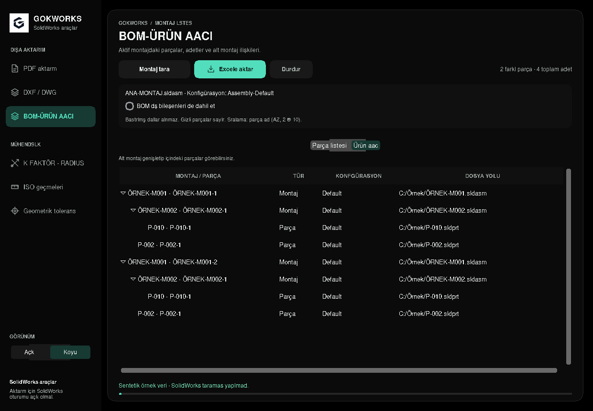

# Güncel arayüz

Yeni: **Mühendislik hesapları → Cıvata hesabı**. [Hesap ve kapsam](../bolt-calculator.md) · [Açık tema](../reports/bolt/screenshots/tension-light.png) · [Koyu tema](../reports/bolt/screenshots/combined-dark.png). Aşağıdaki eski ekranlar cıvata menüsü eklenmeden önce çekilmiştir.

13 Ekim 2026. Altı çalışma alanı ortak bir tasarımla yenilendi: koyu lacivert
menü, açık temada beyaz kartlar, koyu temada katmanlı lacivert yüzeyler ve
yeşil ana işlem düğmeleri. Logo korunur. Görseller çalışan Tk uygulamasından
alındı; SolidWorks bağlantısı veya gerçek CAD çıktısı içermez.

- Çalışma alanını çevreleyen ikinci çerçeve kaldırıldı; içerik kartları ayrıldı.
- PDF/DXF klasör seçimleri numaralandırıldı; seçenekler ayrı başlıkta toplandı.
- Sayaçlar, başlıklar ve tablo satırları daha okunaklı hale getirildi.
- BOM'da toplam adet vurgulandı; seçili satır diğer alt montajlardan ayrıldı.
- Seçili BOM bileşeninin türü ayrıntı panelinde simgeyle gösterilir.
- Dar K/R alanında sayaç simgeleri kaldırılarak başlıklara yer açıldı.

| Çalışma alanı | Açık tema | Koyu tema |
| --- | --- | --- |
| PDF | [Görüntü](screenshots/pdf-light.png) | [Görüntü](screenshots/pdf-dark.png) |
| DXF / DWG | [Görüntü](screenshots/dxf-dwg-light.png) | [Görüntü](screenshots/dxf-dwg-dark.png) |
| K/R · Takım | [Görüntü](screenshots/k-factor-light.png) | [Görüntü](screenshots/k-factor-dark.png) |
| K/R · Manuel | [Görüntü](screenshots/k-factor-manual-light.png) | [Görüntü](screenshots/k-factor-manual-dark.png) |
| ISO geçmeleri | [Görüntü](screenshots/iso-fits-light.png) | [Görüntü](screenshots/iso-fits-dark.png) |
| Geometrik toleranslar | [Görüntü](screenshots/geometric-tolerances-light.png) | [Görüntü](screenshots/geometric-tolerances-dark.png) |
| BOM · Parça listesi | [Görüntü](../reports/bom/screenshots/bom-parts-light.png) | [Görüntü](../reports/bom/screenshots/bom-parts-dark.png) |
| BOM · ürün ağacı | [Görüntü](../reports/bom/screenshots/bom-tree-light.png) | [Görüntü](../reports/bom/screenshots/bom-tree-dark.png) |

## Açık tema · ISO geçmeleri

## Koyu tema · DXF / DWG

## BOM · ürün ağacı

## Manuel K/R

## Geometrik toleranslar

[1000 × 690 DXF ekranı](screenshots/dxf-dwg-dark-small.png) · [1000 × 690 manuel K/R](screenshots/k-factor-manual-dark-small.png).

Görüntülerin dosya özetleri ve çekim bilgileri [screenshots.json](screenshots.json) içindedir. Yeniden üretmek için çalışan sanal ekranda `docs/report-tools/capture_workspaces.py --output-dir docs/ui-preview` kullanılır. Bulutun Python 3.13 / Tk 8.6 ortamı düzgün kenarlı yazı görüntülemesi sağlar; Windows uygulaması Segoe UI kullanır.

Bu tasarım için **7 hedefli arayüz kontrolü geçti**: çalışma alanlarının farklı
pencere ve %100/%125/%150 ölçeklerde yerleşimi, referans sayfaları arasında
geçiş, hızlı menü seçimi, metin/zemin kontrastı, BOM küçük pencere ve tema
geçişleri, BOM seçim/dal kontrolleri ve tarama–Excel akışı. Kontrast kontrolü
yeni sol menüyü de kapsar. 19 genel ekran ve 7 BOM ekranı yeniden çekildi.
Genel hesaplama/aktarım test paketi bu görsel değişiklik için çalıştırılmadı.

[Türkçe metin denetimi ve doğrulama kayıtları](../reports/language-review/README.md).
