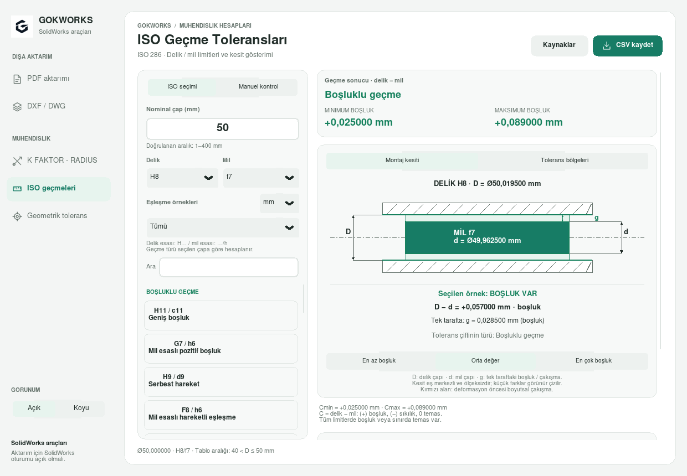
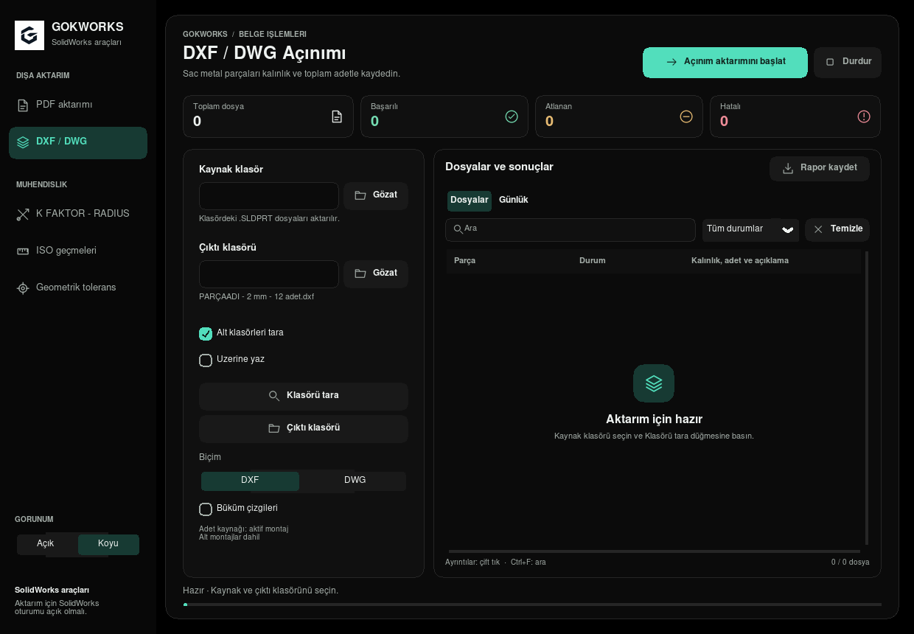
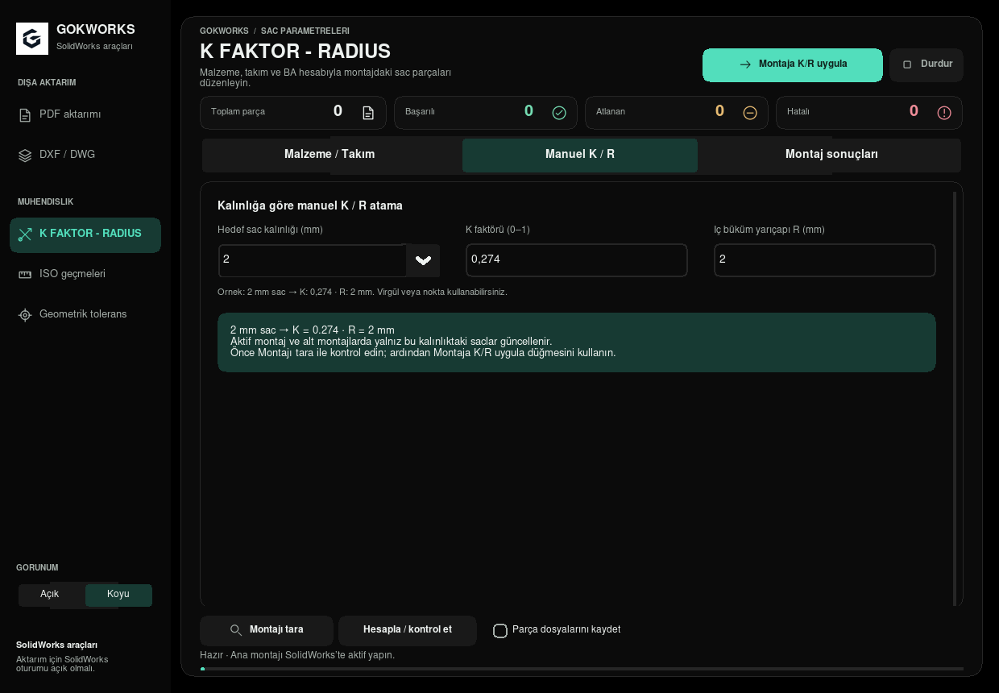
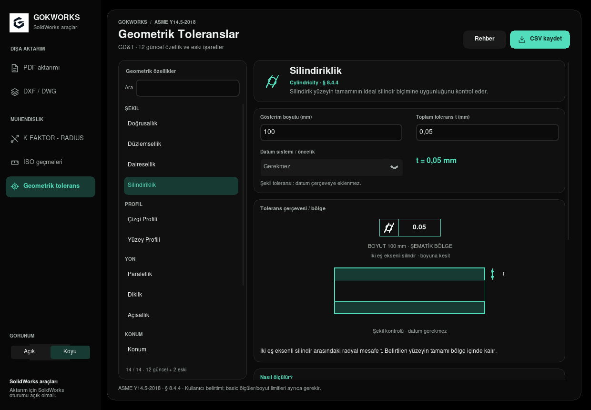

# Güncel arayüz

11 Ekim 2026. Kullanıcının gönderdiği uygulama logosu yan menüye ve pencere simgelerine eklendi. Görseller çalışan Tk uygulamasından, Linux sanal ekranında 1240 × 860 boyutunda alındı. Açık ve siyah tema, yeşil vurgu, dışa aktarım / mühendislik menü grupları ve bağımsız çalışma alanları gösteriliyor. K/R alanlarına örnek değerler girildi; bu görüntüler SolidWorks'e uygulama veya gerçek CAD çıktısı kanıtı değildir.

| Çalışma alanı | Açık tema | Koyu tema |
| --- | --- | --- |
| PDF | [Görüntü](screenshots/pdf-light.png) | [Görüntü](screenshots/pdf-dark.png) |
| DXF / DWG | [Görüntü](screenshots/dxf-dwg-light.png) | [Görüntü](screenshots/dxf-dwg-dark.png) |
| K/R · Takım | [Görüntü](screenshots/k-factor-light.png) | [Görüntü](screenshots/k-factor-dark.png) |
| K/R · Manuel | [Görüntü](screenshots/k-factor-manual-light.png) | [Görüntü](screenshots/k-factor-manual-dark.png) |
| ISO geçmeleri | [Görüntü](screenshots/iso-fits-light.png) | [Görüntü](screenshots/iso-fits-dark.png) |
| Geometrik tolerans | [Görüntü](screenshots/geometric-tolerances-light.png) | [Görüntü](screenshots/geometric-tolerances-dark.png) |

## Açık tema · ISO geçmeleri

## Siyah tema · DXF / DWG

## Manuel K/R

## Geometrik toleranslar

[1000 × 690 DXF ekranı](screenshots/dxf-dwg-dark-small.png) · [1000 × 690 manuel K/R](screenshots/k-factor-manual-dark-small.png).

Görüntülerin dosya özetleri ve çekim bilgileri [screenshots.json](screenshots.json) içindedir. Yeniden üretmek için çalışan sanal ekranda `docs/report-tools/capture_workspaces.py --output-dir docs/ui-preview` kullanılır. Bulutun Python 3.13 / Tk 8.6 ortamı düzgün kenarlı yazı görüntülemesi sağlar; Windows uygulaması Segoe UI kullanır.
