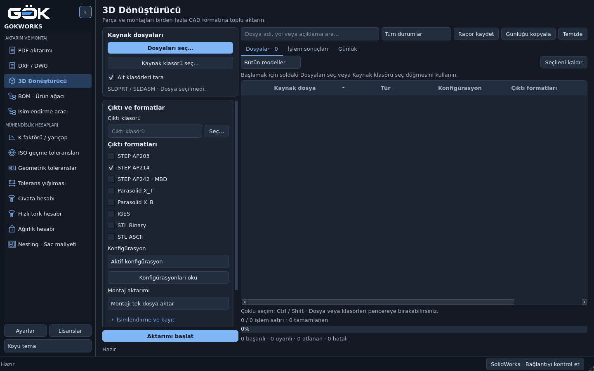
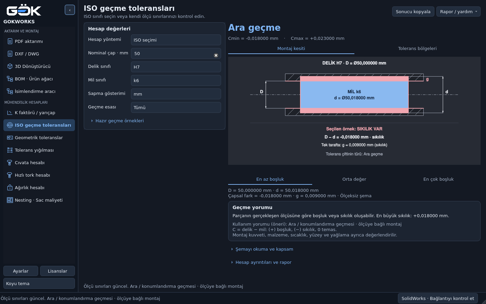
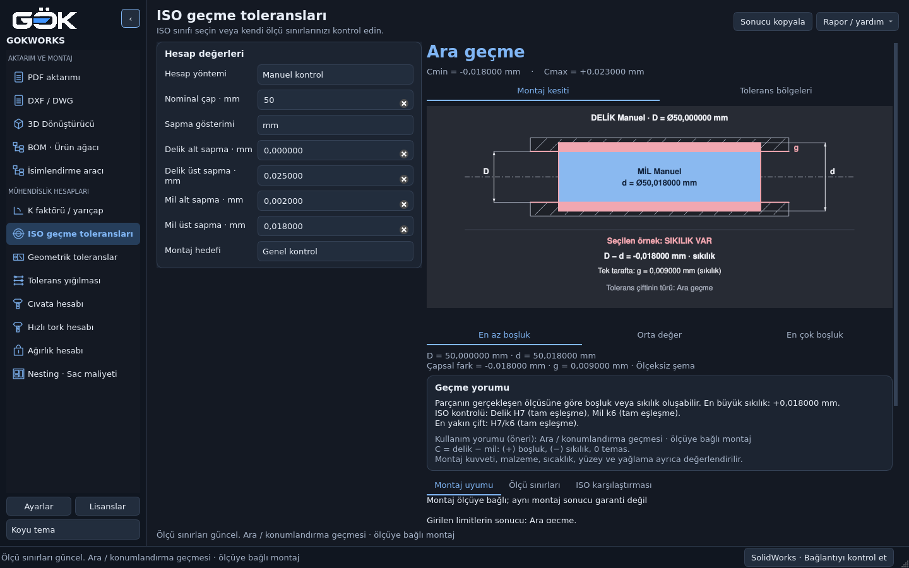

# Kaynak seçimi ve ortak geçme kesiti

22 Ekim 2026 · `main` · PySide6 / Qt Widgets.

## 3D Dönüştürücü

**Kaynak dosyaları** kartı sol üsttedir. **Dosyaları seç…** çoklu SLDPRT/SLDASM
seçer, **Kaynak klasörü seç…** klasörü tarar. Kaynak seçimi, altındaki çıktı ve
format ayarları kaydırılırken sabit kalır. Kaynak klasörü ayrı hatırlanır;
dosya/klasör eklemek çıktı yolunu değiştirmez. Boş listede başlangıç yönergesi
gösterilir. Çalışan iş sırasında kaynak değiştirme kilidi korunur.



[Açık tema](cad-source-light.png) · [820×560 pencere](cad-source-small.png).

## ISO ve manuel kontrolde aynı kesit

Her iki yöntem `modules/iso_fits/diagram.py` çizimini kullanır. Aynı limitler
aynı geometriyi, D/d/g oklarını, boşluk/sıkılık alanlarını ve örnek sonucunu
verir. ISO sınıfları veya **Manuel** etiketi güncel girdilere göre gösterilir.
Tolerans bölgeleri ve üç örnek seçimi aynı sekmelerden kullanılır.

| ISO seçimi · Ø50 H7/k6 | Manuel kontrol · aynı limitler |
| --- | --- |
|  |  |

[Açık tema ISO](fit-iso-light.png) · [Açık tema manuel](fit-manual-light.png).

Kesit ölçeksizdir. Kırmızı alan montaj öncesi boyutsal çakışmadır; montaj
kuvveti veya deformasyon hesabı değildir. Hesaplama motorları değiştirilmedi.

## Doğrulama

Linux, Python 3.13.5, PySide6 6.10.3, `QT_QPA_PLATFORM=offscreen`:

```bash
python -m pytest -q modules/iso_fits/tests modules/cad_converter/tests tests/test_qt_workflows.py -k 'iso or cad_converter'
python main.py --self-check docs/ui-source-and-fit/selfcheck.json
```

- 147 test ve 353 alt test geçti; 130 ilgisiz test filtrelendi.
- Bir canlı CAD aktarım testi atlandı: Windows, açık SolidWorks ve açıkça
  seçilmiş test modeli gerekir. Canlı SolidWorks işlemi doğrulanmadı.
- Boşluklu, ara, sıkı geçme ve sıfır temas için her iki görünüm ve üç örnek,
  koyu/açık temada ISO ile eşdeğer manuel sınırlar karşılaştırıldı.
- 820×560, 1024×700 ve 1440×900 boyutlarında kaynak düğmelerinin konumu,
  ayarları kaydırırken erişimi ve kesit yazılarının görünürlüğü doğrulandı.
- Gerçek düğme tıklamaları, taklit dosya seçici yanıtı ve gerçek tarama işiyle
  çoklu kaynak ekleme test edildi; çıktı klasörü korunur.
- [Uygulama öz denetimi](selfcheck.json) 13 modül, iki tema ve dört
  çözünürlükte geçti. Bu kaynak kodu kontrolüdür; yeni Windows EXE derlemesi
  veya gerçek SolidWorks testi olarak raporlanmaz.

Ekranlar çalışan Qt arayüzünden alınmıştır. CAD dosya içeriği kullanılmadı.
