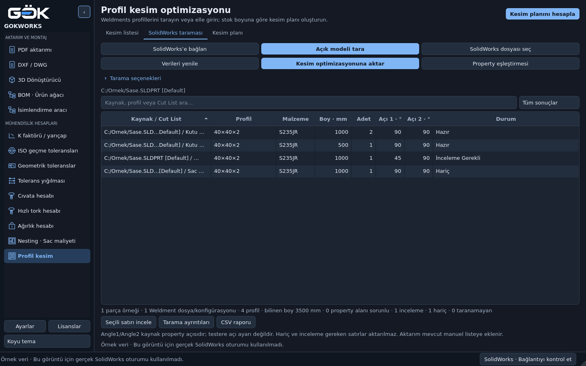

# Profil kesim optimizasyonu ve SolidWorks Weldments

GOKWORKS → **Mühendislik Hesapları → Profil kesim**.
Mevcut PySide6 teması, kalıcı sayfalar, tablo modelleri ve `JobManager` kullanılır.
Yeni bağımlılık yoktur. Manuel kesim planı tamamen çevrimdışıdır; Weldments
taraması Windows, pywin32 ve açık/lisanslı SolidWorks oturumu gerektirir.

## Kullanım

1. **SolidWorks taraması** sekmesinde **SolidWorks’e bağlan** ile oturumu
   kontrol edin. **Açık modeli tara** veya **SolidWorks dosyası seç** ile
   kaydedilmiş SLDPRT/SLDASM okuyun. Dosya seçimi native dosyayı Python ile
   çözmez; kurulu SolidWorks üzerinden salt okunur açar.
2. **Property eşleştirmesi** ile özel isimleri tanımlayın. Her alanın alternatif
   property adlarını noktalı virgülle ayırın. Yeni eşleştirme için **Verileri
   yenile** kullanın. Ham property ifadesi, çözümlenmiş değer yerine kullanılmaz.
3. Durum filtresinden **İnceleme Gerekli** veya **Hariç** seçerek bu kayıtları
   ayrı listeleyin. Kaynak dosya, konfigürasyon ve Cut List aynı satırda,
   ham/çözümlenmiş özellikler **Tarama ayrıntıları** içindedir. Sayısal hücreler
   ve profil/malzeme düzenlenebilir; kaynak CAD parametreleri değiştirilmez.
4. Gerekli satırı seçip **Seçili satırı incele** ile kesiti, miktarı, boyu,
   et kalınlığını, standardı, stok kodunu ve ek ham boyu düzeltin. Doğrulama
   kutusu ve açıklama notu zorunludur. Sac/levha/diğer katı grupları bu yoldan
   profil gibi onaylanamaz; kapsam dışında kalır.
5. **Kesim optimizasyonuna aktar** yalnız hazır satırları mevcut listeye ekler.
   Manuel kayıtlar silinmez. Aynı tarama tekrar eklenmez. Kaynak değişmişse
   önceki aktarım korunur ve uyarılır; yenisini almak için ilgili eski satırı
   kullanıcı seçip kaldırır. Kaydedilmiş tarama yeniden aktarılmadan önce
   SolidWorks’ten yenilenmelidir.
   Klasör adları değişse veya gövdeler başka Cut List gruplarına taşınsa da
   kaynak kapsamı ve gövde kimlikleriyle ikinci aktarım engellenir.
6. **Kesim listesi** sekmesinde stok boyu, testere payı ve bir uç için düzeltme
   girin. Varsayılanlar 6000 / 3 / 0 mm’dir. **Kesim planını hesapla** ile
   stokları görün. Stok satırı seçilince şeması değişir.
7. **Kaydet / Proje aç** sürümlü `.gokprofile` JSON dosyası kullanır. Planlar
   yeniden hesaplanır. **CSV raporu** taramayı, ham property ifadelerini,
   kaynakları, doğrulama notlarını ve kesim sırasını yerel dosyaya yazar.



[Açık tema](../../docs/profile-cutting/scan-light.png) ·
[Kesim planı](../../docs/profile-cutting/plan-dark.png) ·
[Küçük pencere](../../docs/profile-cutting/small.png).
Görseller açıkça örnek veriyle alınmıştır; gerçek CAD entegrasyon testi değildir.

## API ve tarama davranışı

- `IFeature.GetTypeName2() == "CutListFolder"` ve `GetSpecificFeature2()`
  üzerinden `IBodyFolder` okunur. Üst/alt unsurlar taranır; aynı unsur ve
  gövde ikinci kez sayılmaz. `GetBodies()` / `GetBodyCount()` / `QUANTITY`
  uyuşmazlığı otomatik aktarımı engeller. Adet kaynağı gerçek gövdelerdir.
- `ICustomPropertyManager.Get6(name, False, ...)`: ham ifade, evaluated değer,
  çözümleme durumu ve bağlantı bilgisi ayrı tutulur. Eşleştirme büyük/küçük
  harf duyarsızdır; çelişen alias değerleri sessizce seçilmez.
- Alt montajlar yalnız üst seviye `GetComponents(True)` ile recursive açılır;
  düz listeyle ikinci sayım yapılmaz. Dosya/konfigürasyon bir kez okunur,
  gerçek montaj örnekleri kadar çarpılır. Farklı referenced configuration
  ayrı kayıttır. Suppressed kayıtlar raporlanıp hariç tutulur. Lightweight
  referanslar ayrı salt okunur dosyadan okunur; montajın çözümleme ayarı
  değiştirilmez. Sanal/eksik/kimliği tutarsız bileşenler açık hatadır.
- COM aynı worker STA içinde `CoInitialize/CoUninitialize` ile yönetilir.
  GUI’ye yalnız Python veri modelleri geçer. Önceki aktif belge ve değişen
  konfigürasyon geri alınır; geri alma başarısızsa tarama yayımlanmaz.
  Yalnız aracın açtığı dosyalar kapatılır; `Save` çağrılmaz.
- Bekleyen rebuild veya güncelliği bilinmeyen Cut List inceleme gerektirir.
  **Tarama seçenekleri → Cut List’i güncelle** kullanıcı tercihidir;
  `UpdateCutList()` uygulanır, kaynak kaydedilmez. Otomatik güncelleme
  seçenekleri kalıcı değiştirilmez. Rebuild gerekiyorsa kullanıcı bunu
  SolidWorks’te yapıp yeniden taramalıdır.

## Boy, kesit ve açı kapsamı

Öncelik çözümlenmiş LENGTH’tir. Birimsiz property metni dokümanın gösterim
birimindedir; `mm/cm/m/in/ft` soneki varsa açık birim kullanılır. Geometri
API koordinatları metre kabul edilip mm’ye çevrilir. Binlik ayraçlı veya
çözümlenmemiş ifadeler değerlendirilmez; Python `eval` kullanılmaz.

Bounding box boy hesabı yapılmaz. Doğrulama, iki uç düzlemi ile bütün yan
yüzeylerin aynı eksene paralel düzlem/silindir olmasını ister. Ara uç yüzü,
eğik düzlem, çapraz delik, torus/spline veya belirsiz eksen otomatik doğrulamayı
geçmez. LENGTH/geometri farkı en fazla `max(0,001 mm, LENGTH × 1e-7)` olabilir.
Bu kontrol üretim toleransı veya kesit standardı sertifikası değildir.

Eksik LENGTH için geometri alternatifi varsayılan kapalıdır. Yalnız **Eksik
LENGTH için ... geometriden boy al** seçildiğinde tek ekseni doğrulanmış
gövdelerin uç düzlemi mesafesi kullanılabilir; 0,001 mm’ye yukarı yuvarlanır
ve boy kaynağı açıkça raporlanır. Belirsiz katı blokların en büyük boyu seçilmez.

Kesit ve kalite, çözümlenmiş property verisinden gelir. Tanımsız “Profile”
gibi genel açıklamalar otomatik ortak havuza alınmaz. 40×40×2 / Ø42,4×2 gibi
mm tanımlarından et alınabilir; property et değeriyle çelişirse inceleme gerekir.
Gruplama kesit + et + malzeme + standart + stok kodudur. Kaynak dosya farklı
olsa da aynı grup ortak havuz kullanır; S235JR, S355JR veya ST37 eşdeğer sayılmaz.
mm dışındaki dokümanlarda kesit adının birimi, standart/stok kimliğiyle açık
değilse manuel doğrulama istenir; DESCRIPTION içindeki ölçüler rastgele mm
sayılmaz. LENGTH birim dönüşümü bundan bağımsızdır. Etin `2`/`2,00` yazımı ve
kesitteki `x`/`×` çevresindeki boşluklar aynı grup olarak değerlendirilir.

Angle1/Angle2 **SolidWorks property açılarıdır**; testere açısına otomatik
çevrilmez. Kare uç geometrisi doğrulanmadan 0°/90° metni güvence sayılmaz.
45° ve diğer özel kesimler inceleme gerektirir. Uzun uç/ham stok gereksinimi,
yön ve ek boy kullanıcı tarafından üretim resminden doğrulanıp not edilir.
Ek ham boy testere payından ayrıdır. Karşılıklı gönye birleştirme/ortak kesim,
cope, kavis ve özel Trim/Extend geometrisinin otomatik CAM planı desteklenmez.
Montaj düzeyinde parça Cut List’ine yansımayan geometri unsurları algılanırsa
etkilenen alt kayıtlar da incelemeye alınır; bunlar otomatik uygun sayılmaz.

## 1D optimizasyon ve sınırlar

Güncel çalışma ağacında önceden bir 1D profil motoru bulunmadığı için bu modül
eklendi; mevcut 2D sac nesting değiştirilmedi.

Her grubun sabit boy stokları sınırsız satın alma havuzu olarak ele alınır.
Farklı gruplar aynı çubuğu paylaşmaz. Tüketim:

`2 × uç düzeltme + Σ(nominal boy + ek ham boy + testere payı)`

Testere payı her parçaya uygulanır; stok ucunun kesimsiz kullanılabileceği
son parça için pay otomatik kaldırılmaz. Kesim sayısı, boylar, grup ve kalan
boy plan sonunda bağımsız doğrulanır. Decimal hesapla boylar korunur.

Best-fit decreasing başlangıç planı kurar. En fazla 22 parçalık gruplarda,
toplam 2 saniyelik bütçe içinde daha az stok sayısı için tam arama yapılır.
Alt sınıra erişildiğinde veya daha küçük sayılar tüketildiğinde minimum stok
adedi doğrulanır. Aksi durumda **minimum garanti edilmez** yazılır. Farklı
satın alma stok boyları, sınırlı envanter ve maliyet bazlı stok seçimi yoktur.
Tek planda 20000 profil; proje dosyasında 20 MB sınırı vardır.

## Dosyalar ve doğrulama

`models.py`: saf veri/aktarım; `properties.py`: mapping/birim; `geometry.py`:
doğrusal doğrulama; `solidworks.py`: raw COM; `scanner.py`: montaj/tarama;
`optimizer.py`: 1D motor; `storage.py`: atomik JSON/CSV; `ui.py`/`dialogs.py`:
mevcut Qt mimarisine entegrasyon. `tests/` matematik, COM doubles, gerçek Qt
ve isteğe bağlı canlı Windows testini içerir.

```bash
QT_QPA_PLATFORM=offscreen python -m pytest modules/profile_cutting/tests
python main.py
python main.py --self-check /tmp/gokworks-check.json
```

Windows’ta canlı doğrulama için SolidWorks’te bir kayıtlı test kopyası açın:

```powershell
$env:GOKWORKS_WELDMENT_LIVE_SOURCE = 'C:\Test\Weldment.SLDPRT'
$env:GOKWORKS_WELDMENT_EXPECTED_COUNT = '5'
python -m pytest modules/profile_cutting/tests/test_live.py -v
```

Canlı test kaynak dosya SHA256’sını ve önceki aktif belge/konfigürasyonu
kontrol eder; beklenen adet opsiyoneldir. Linux’ta bu test atlanır ve başarılı
diye raporlanmaz. Gerçek montaj, kurulu sürümün property birimi ve özel kesim
geometrileri Windows/SolidWorks üzerinde ayrıca doğrulanmalıdır.

[Araştırma/lisans kayıtları](../../docs/profile-cutting/references.json) ·
[API metadata sözleşmesi](../../docs/profile-cutting/api-contract.json) ·
[Test ve uygulama raporu](../../docs/PROFILE_CUTTING_IMPLEMENTATION.md).
